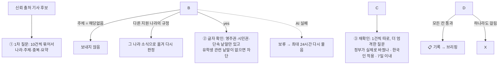

# 놓치지마 (nochijima)

> 해외에 있는 소중한 사람이 사는 \*\*나라·도시\*\*에서 생긴 \*\*지진·재난·환율·제도 변화·대형 사고\*\*를 자동으로 살펴보고, 중요한 것만 골라 \*\*한국어로, 카카오톡으로\*\* 먼저 알려 주는 서비스다.
> 코딩을 배우지 않은 상태에서 \*\*Claude Code\*\*와 대화하며 만든 바이브 코딩 과제다.

|구분|주소|
|-|-|
|🌐 웹페이지|https://dainty-creponne-765c4f.netlify.app|
|💻 GitHub|https://github.com/pes79/NOCHIJIMA-VICE|

\---

## 목차

**Ⅰ. 서론 — 개발 배경 및 목적**

1. [개발 동기](#1-개발-동기)
2. [시장 자료 — 해외와 연결된 사람은 얼마나 되나](#2-시장-자료--해외와-연결된-사람은-얼마나-되나)
3. [문제 정의 — 실제로 받은 카톡 답](#3-문제-정의--실제로-받은-카톡-답)
4. [유사 서비스 검토](#4-유사-서비스-검토)
5. [대상과 제공 기능](#5-대상과-제공-기능)

**Ⅱ. 본론 — 서비스 구현 상세**

6. [전체 구조](#6-전체-구조)
7. [사용 기술](#7-사용-기술)
8. [폴더 구조와 파일 목록](#8-폴더-구조와-파일-목록)
9. [서비스 제공 가능 지역 (나라 – 도시)](#9-서비스-제공-가능-지역-나라--도시)
10. [감시 모듈 상세](#10-감시-모듈-상세)
11. [지역 필터 로직](#11-지역-필터-로직)
12. [AI 판단 로직](#12-ai-판단-로직)
13. [발송·브리핑 로직](#13-발송브리핑-로직)
14. [자기 감시 (멈춤을 스스로 알아채는 장치)](#14-자기-감시-멈춤을-스스로-알아채는-장치)
15. [데이터 저장](#15-데이터-저장)
16. [알림 하나가 만들어지기까지 (예시)](#16-알림-하나가-만들어지기까지-예시)
17. [틀린 알림을 줄이는 장치 (요약)](#17-틀린-알림을-줄이는-장치-요약)
18. [실행 방법](#18-실행-방법)
19. [Claude Code로 만든 과정 (바이브 코딩)](#19-claude-code로-만든-과정-바이브-코딩)
20. [시행착오와 해결](#20-시행착오와-해결)

**Ⅲ. 결론**

21. [결과](#21-결과)
22. [한계와 향후 보완 사항](#22-한계와-향후-보완-사항)
23. [실제 사용자 피드백](#23-실제-사용자-피드백)
24. [배운 점](#24-배운-점)

**부록**

* [부록 A. 고를 수 있는 주·도·현 전체 목록 (802곳)](#부록-a-고를-수-있는-주도현-전체-목록-802곳)
* [부록 B. 나라별 신뢰 출처 목록](#부록-b-나라별-신뢰-출처-목록)
* [부록 C. 자료 출처](#부록-c-자료-출처)

\---

# Ⅰ. 서론 — 개발 배경 및 목적

## 1\. 개발 동기

2026년 7월 28일, 일본 구마모토에서 지진이 났다. 나는 그 소식을 뉴스가 아니라 **일본에 사는 소중한 사람에게서 먼저** 들었다. 그 사람이 알려 주기 전까지는 아무것도 몰랐다.

그때 든 생각은 하나였다.

> \*\*정보는 세상에 넘치는데, 나한테 제때 도착하지는 않는다.\*\*

뉴스는 내가 찾아가야 보이고, 현지 재난 앱은 현지어라 읽기 어렵고, 한국 뉴스는 큰 사건이 아니면 늦거나 다루지 않는다. 그래서 **"내가 고른 나라·도시에 일이 생기면, 한국어로, 매일 보는 카카오톡으로 먼저 알려 주는 것"** 을 직접 만들어 보기로 했다.

**목적:** 정보를 새로 만드는 서비스가 아니라, 이미 있는 정보를 필요한 사람에게 **"도달"시키는 서비스**를 만드는 것.

## 2\. 시장 자료 — 해외와 연결된 사람은 얼마나 되나

"다른 나라에 가족·연인이 있는 사람"이 실제로 얼마나 되는지 공식 통계로 확인했다.

|지표|수치|기준 시점|출처|
|-|-|-|-|
|재외동포 (해외에 사는 한인)|**7,006,703명** (181개국)|2024-12-31|재외동포청 「2025 재외동포현황」|
|└ 그중 한국 국적자 (재외국민)|**2,402,026명**|2024-12-31|같은 자료|
|해외 대학 등에서 공부하는 한국인 유학생|**129,726명**|2025년 4월|교육부 「국외 고등교육기관 한국인 유학생 현황」|
|다문화(국제) 혼인|**21,399건** (전체 혼인의 **8.9%**)|2025년 한 해|국가데이터처 「2025년 다문화 인구동태통계」 (2026-11-05 발표)|

**놓치지마가 지원하는 나라의 재외동포 수 (상위)**

|나라|재외동포|나라|재외동포|
|-|-|-|-|
|🇺🇸 미국|2,557,047명|🇦🇺 호주|170,215명|
|🇯🇵 일본|960,970명|🇷🇺 러시아|113,042명|
|🇨🇦 캐나다|263,153명|🇵🇭 필리핀|52,695명|
|🇻🇳 베트남|192,683명|||

> 중국(1,848,241명)은 재외동포가 두 번째로 많지만, 구글 뉴스 자료가 부실해 정책 뉴스 감시에서 뺐다(10장 참고).

**한국인 유학생 수의 흐름 (교육부, 매년 4월 기준)**

|연도|2011|2020|2021|2022|2023|2024|2025|
|-|-|-|-|-|-|-|-|
|유학생 수|262,465 (최고)|194,916|156,520|124,320|123,181|126,980|129,726|

**자료를 읽을 때 주의할 점**

* 유학생 수는 **대학 등 고등교육기관만** 센 것이다. 초·중·고 조기유학생과 어학연수생은 빠져 있다.
* 다문화 혼인은 **한국에 신고된 혼인**만 센 것이다. 해외에서 사는 국제커플, 결혼하지 않은 국제 연인은 빠져 있다.
* 그래서 "해외와 연결된 사람"은 위 숫자보다 많다. 다만 이 숫자는 **연결된 사람이 많다**는 것을 보여 줄 뿐, **돈을 내고 알림을 받을 사람**이 많다는 증거는 아니다. 그 부분은 3장과 23장에서 직접 확인했다.

## 3\. 문제 정의 — 실제로 받은 카톡 답

해외에 가족·지인을 둔 사람들이 실제로 소식을 어떻게 챙기는지, **카카오톡 오픈채팅방에 들어가 직접 물어봤다** (2026년 10월). 아래는 받은 답을 짧게 옮긴 것이다(이름 등 개인 정보는 뺐다).

### 💬 해외 유학생 학부모 오픈채팅 (캐나다 밴쿠버 학부모가 많은 방)

> \*\*학부모 A\*\* — 영사관 사이트(재난), 비자 사이트, 네이버 환율을 \*\*매일 직접 들어가서\*\* 확인한다.
>
> \*\*학부모 B\*\* — 매일 아침 AI(제미나이 등)에게 \*\*현지 학교 행사, 간밤 사건사고, 환율 요약\*\*을 시킨다.
>
> \*\*학부모 C\*\* — 크롤러와 메신저 API로 \*\*직접 만들어서\*\* 받는다.
>
> \*\*학부모 D\*\* — 자녀 넷을 해외에 보냈을 때, \*\*알아듣지도 못하는 현지 뉴스 채널을 틀어 두고\*\* 매일 은행에 들렀다.
>
> \*\*일부 학부모\*\* — "정보 모아서 앱 만들거나 광고하려는 것 아니냐"며 의심했다.

### 💬 영국 어학연수 오픈채팅

> 해외에 있을 때 큰 사건(테러 등)이 나면, \*\*부모님이 한국 뉴스로 먼저 보고\*\* 연락하는 경우가 많았다.

### 💬 일본 취업 관련 오픈채팅

> 요즘은 SNS가 크다. 현지에 사는 사람이 직접 운영하는 채널·매거진 계정으로 소식을 접한다.

### 💬 다른 오픈채팅

> 무소식이 희소식이다.

### 💬 그 밖에 직접 받은 답

|누구|받은 답|
|-|-|
|해외에서 한국 학생 학원을 운영하는 지인|그 나라 교민 대상 인스타 '교민 뉴스' 계정이 있다. 맛집 할인·현지 면허·폭우 예보 같은 생활 정보 위주이고, 빠르지는 않다.|
|지인 3\~5명|"잘 만들었다." 하지만 돈 내고 쓸 사람이 있을지는 모르겠다.|
|창업 멘토링 (2026-10-26)|현지 한인 카페가 이미 소식을 다 알려 준다. 100명 이상 시장 조사가 필요하다. "아이디어가 나부터 설득돼야 한다."|

### 정리 — 문제는 세 가지였다

1. **언어** — 현지 공식 자료와 뉴스는 현지어라 읽기 어렵다
2. **찾아가야 함** — 여러 사이트를 매일 직접 확인해야 한다
3. **속도** — 한국 뉴스는 늦거나, 작은 지역 소식은 아예 다루지 않는다

동시에 **"이미 다른 방법(한인 카페·SNS·AI)으로 챙기고 있다"** 는 답도 많았다. 이 점은 결론(23장)에서 다시 다룬다.

## 4\. 유사 서비스 검토

|서비스|하는 일|놓치지마와 다른 점|
|-|-|-|
|**외교부 '해외안전여행' 앱**|국가별 여행경보·안전 공지 푸시, 위기상황 대처 안내|**여행하는 본인** 중심, 나라 단위 경보. 도시 단위 재난·환율·현지 제도 변화는 다루지 않음. 앱 설치 필요|
|**일본 관광청 'Safety tips' 앱**|일본의 지진·쓰나미·기상 특보를 15개 언어(한국어 포함)로 푸시|**일본만** 다룸(지역 5곳까지). 환율·제도 변화 없음. 앱 설치 필요|
|**구글 알리미·뉴스 앱 키워드 알림**|정한 키워드가 들어간 기사를 알려 줌|거르지 않아서 **관계없는 기사가 많고**, 현지어 기사는 그대로 옴|
|**현지 한인 커뮤니티·SNS 채널**|현지 사람이 소식을 빠르게 올림|**내가 찾아가서** 봐야 함, 출처·정확도가 들쑥날쑥|
|**은행 앱 환율 알림**|정한 환율에 도달하면 알림|**환율만** 다룸|

**놓치지마의 차별점**

* 30개 나라를 **주·도·현 또는 도시 단위**로 골라서
* 재난·환율·현지 제도 변화·대형 사고를 **한 곳에서**
* **한국어로 정리**해서
* 앱 설치 없이 **매일 쓰는 카카오톡**으로
* **여행자 본인이 아니라 한국에 있는 가족** 입장에서 보내 준다

## 5\. 대상과 제공 기능

### 대상

|대상|설명|
|-|-|
|**해외에 자녀를 둔 부모** (핵심)|유학생 학부모. 아이가 사는 도시의 재난·비자·환율이 늘 걱정인 사람|
|**국제커플**|연인·배우자가 다른 나라에 사는 사람 (만든 사람 본인도 여기에 해당)|
|**해외에 가족·지인이 있는 사람**|해외 거주 가족, 장기 체류 지인 등 그 나라와 연결된 사람|

### 제공 기능

|알림|무엇을 보나|자료 출처|
|-|-|-|
|🌏 **지진**|규모 4.0 이상(일본 4.5, 알래스카 5.0), 고른 지역과의 거리|미국 지질조사국(USGS)|
|🌧️ **기상·재난**|폭우·홍수 특보, 태풍·산불·화산·홍수, 미국 토네이도 등|일본·미국·말레이시아 기상청, GDACS(UN·EU 재난 경보), open-meteo 강수량|
|💱 **환율**|평소보다 크게 움직였을 때, 30일 최저·최고|하나은행 고시 환율|
|📋 **제도 변화**|학생비자·체류허가·입국·아르바이트·건강보험·운전면허 등 규정 변경|나라별 신뢰 언론·정부 발표 + AI 최종 판단|
|🚨 **대형 사고**|사망·실종 5명 이상 등 대형 인명사고, 인명 피해가 난 산사태|나라별 신뢰 언론 + AI 최종 판단|
|🗓 **브리핑**|조용한 날에도 아침·저녁 한 번, 매주 요약 한 번|위 자료 종합|

**다루지 않는 것:** 전쟁·정치 분쟁. 너무 복잡하고 민감해서, 사실을 짧게 전달하는 알림에는 맞지 않는다고 판단했다.

\---

# Ⅱ. 본론 — 서비스 구현 상세

## 6\. 전체 구조

놓치지마는 **프론트엔드(웹페이지)**, **백엔드(감시·판단·발송 프로그램)**, **데이터 저장(JSON 파일)**, **외부 서비스(공공 자료·AI·카카오)** 네 부분으로 나뉜다. 별도의 데이터베이스 서버 없이, 필요한 기록은 **JSON 파일과 날짜별 로그 파일**로 저장한다.

```mermaid
flowchart TB
    EXT\["외부 자료<br/>USGS · 기상청 3곳 · GDACS<br/>open-meteo · 환율 · 구글 뉴스"] --> M\["감시 모듈 9개<br/>(10분\~1시간마다)"]
    M --> AI\["AI 판단 · Gemini<br/>(뉴스만)"] --> LOG\[("logs/<br/>날짜별 알림 기록")]
    M --> LOG
    M <--> SEEN\[("\*\_seen.json<br/>중복 기록")]
    LOG --> F\["지역 필터"] --> S\["발송 · 브리핑"] --> K(\["카카오톡"])
    CFG\[("설정 · 지역 802곳")] --> F
    M --> HB\[("heartbeat.json<br/>실행 기록")] --> W\["자기 감시 ·<br/>일일 점검"]
    W -. 멈춤 경고 .-> K
    FE\["홈페이지<br/>나라·도시 선택"] -. 카톡 채널로 신청 .-> K
```

|구성|역할|사용 기술|
|-|-|-|
|**프론트엔드**|서비스 소개, 알림 받을 나라·도시 선택, 개인정보처리방침|HTML · CSS · JavaScript, Netlify 배포|
|**백엔드**|자료 수집 → 거르기 → AI 판단 → 기록 → 지역 필터 → 발송, 그리고 스스로 점검|Python 3.11, Windows 작업 스케줄러|
|**데이터 저장**|설정, 지역 목록(802곳), 이미 본 소식, 날짜별 알림 기록, 실행 기록|JSON·로그 파일 (DB 서버 없음)|
|**외부 서비스**|자료 출처, AI 판단, 번역, 메시지 발송|공공 API·RSS, Google Gemini API, 구글 번역, Kakao REST API|

## 7\. 사용 기술

|분류|사용한 것|어디에|
|-|-|-|
|언어|**Python 3.11**|감시·판단·발송 프로그램 전체 (파이썬 파일 37개, 약 1만 1천 줄)|
|언어|**HTML · CSS · JavaScript**|홈페이지 3쪽 (소개, 나라·도시 선택, 개인정보처리방침)|
|라이브러리|대부분 **표준 라이브러리** (urllib, json, xml, math, datetime, subprocess 등)|자료 받기, 데이터 처리, 거리 계산, 하위 프로그램 실행|
|라이브러리|`holidays` (선택)|주간 요약의 현지 공휴일 표시|
|외부 API|USGS, 일본 기상청, 미국 기상청, 말레이시아 기상청·배수관개국, GDACS, open-meteo, 네이버 금융(하나은행 고시), 구글 뉴스 RSS|자료 수집|
|외부 API|**Google Gemini API**|뉴스 최종 판단, 한국어 한 줄 요약, 주간 요약|
|외부 API|**Kakao REST API**|카카오톡 '나에게 보내기' 발송|
|실행 환경|**Windows 작업 스케줄러**|10분\~1시간마다 자동 실행|
|배포|**Netlify**|홈페이지|
|개발 도구|**Claude Code**|설계·코딩·시험·문서화 전 과정|
|공개 데이터|Wikidata · GeoNames|30개국 802개 주·도·현 목록과 마을 좌표|

## 8\. 폴더 구조와 파일 목록

```
NOCHIJIMA-VICE/
├─ code/                       ← 백엔드: 감시·판단·발송 프로그램 (.py)
├─ homepage/                   ← 프론트엔드: index.html · signup.html · privacy.html
├─ README.md                   ← 이 보고서
├─ requirements.txt            ← 선택 패키지(holidays)
└─ .gitignore                  ← 키·토큰·기록 파일이 올라가지 않게 막는 목록
```

`code/` 안의 파일을 역할별로 나누면 다음과 같다.

|역할|파일|하는 일 (한 줄)|
|-|-|-|
|**감시**|`지진감시.py`|USGS 지진 자료에서 규모 기준을 넘는 지진을 찾는다|
||`환율감시.py`|22개 통화의 전날·일주일·30일 변화를 계산한다|
||`재난감시.py`|GDACS 국제 재난 경보(산불·홍수·태풍·화산)를 읽는다|
||`일본기상청감시.py`|일본 기상청 호우·홍수 경보를 읽는다|
||`미국기상청감시.py`|미국 기상청 토네이도·허리케인 등 경보를 읽는다|
||`말레이시아기상청감시.py`|말레이시아 기상 특보와 하천 수위를 읽는다|
||`호우감시.py`|163개 도시의 실제 강수량으로 폭우를 직접 잡는다|
||`정책뉴스감시.py`|30개국 뉴스에서 유학생 가족에게 영향이 있는 규정 변화를 찾는다|
||`대형사고감시.py`|30개국 뉴스에서 대형 인명사고·산사태를 찾는다|
||`입국정책감시.py`|미국 국무부 여행경보 변경을 본다 (샘플, 지금은 쓰지 않음)|
|**판단**|`AI판단.py`|뉴스 후보를 Gemini에게 물어 최종 판단한다 (12장)|
||`지역필터.py`|알림이 고른 지역 안·근처인지 계산한다 (11장)|
||`번역도우미.py`|구글 번역 호출 간격·캐시·차단 관리|
||`gemini\_사용량.py`|Gemini 호출 수 기록, 1분 속도 제한, 하루 한도 80% 알림|
|**발송**|`카톡발송.py`|새 알림을 골라 카카오톡으로 보낸다 (13장)|
||`아침브리핑.py`|아침·저녁 브리핑|
||`주간요약.py` · `주간리포트.py`|일주일 요약|
||`스토리감.py`|하루 한 번 '가장 눈에 띈 소식'을 운영자에게만 보낸다 (홍보 참고용)|
||`시스템알림.py`|"감시 멈춤" 같은 시스템 알림을 한 곳에서 보낸다|
||`kakao\_token.py` · `카카오\_토큰받기.py`|카카오 토큰 자동 갱신 · 처음 한 번 받기|
|**관리**|`자동실행기.py`|감시 프로그램을 실행하고 로그·실행 기록을 남긴다 (14장)|
||`자가감시.py`|감시가 조용히 멈췄는지 15분마다 확인한다 (14장)|
||`일일점검.py`|매일 07:30, 지난 24시간 품질 점검 보고서를 만든다 (14장)|
|**데이터 만들기**|`행정구역\_만들기.py` · `나라정보.py`|30개국 주·도·현 목록 생성 · 나라별 국기·대표 도시·시간대|
|**시험**|`AI판단\_테스트.py` 외 9개 (`\*\_테스트.py`, `\*\_재검사.py`)|실제 발송 없이 기준을 시험하거나 지난 기록을 새 기준으로 다시 판정|
|**데이터 파일**|`행정구역.json` · `나라이름.json` · `도시약칭.json`|지역 목록 · 나라 이름(여러 언어) · 도시 줄임말(LA, KL, ロス 등)|
|**예시 설정**|`\*.example.json`|키·설정 예시 (복사해서 사용)|

> 실행할 때 생기는 `logs/`(알림 기록)와 `\*\_seen.json`(중복 기록), 그리고 키가 들어간 설정 파일은 `.gitignore`로 GitHub에 올리지 않는다.

## 9\. 서비스 제공 가능 지역 (나라 – 도시)

### 9-1. 고르는 방법

신청 페이지(`signup.html`)에서 **자녀(또는 가족) 1명당 나라 1곳 + 지역 최대 2곳**을 고른다. 한 번에 최대 5명까지 넣을 수 있다.

|고르는 단위|방법|예|
|-|-|-|
|**주·도·현** (1단계 행정구역)|목록에서 고른다. 30개국 **802곳**이 들어 있다 (부록 A)|홋카이도, 캘리포니아주, 브리티시컬럼비아주|
|**도시**|도시 이름을 검색한다. 목록에 없는 도시도 **그 나라 안이면 어디든** 고를 수 있다 (open-meteo 지명 검색)|미야자키, 밴쿠버, 쿠알라룸푸르|

> 싱가포르는 도시국가라 나라 전체가 한 지역이다.
>
> 같은 이름이 두 가지로 해석될 수 있으면 이렇게 정한다: 주·도·현 공식 이름과 딱 맞으면 그 지역 전체, 대도시 이름이면 그 도시. 예: "도쿄" = 도쿄 시내, "도쿄도" = 도쿄도 전체. 이름 뒤에 "(전역)"을 붙이면 무조건 주·도·현으로 본다.

### 9-2. 나라별로 받을 수 있는 알림

30개국 모두에서 **지진·국제 재난(GDACS)·제도 변화·대형 사고** 알림을 받을 수 있다. 나라마다 다른 부분은 아래 표와 같다.

|나라|고를 수 있는 주·도·현|폭우 직접 감시 도시|환율 알림 통화|나라 전용 기상 특보|
|-|-|-|-|-|
|🇯🇵 일본|47곳|도쿄, 오사카, 후쿠오카, 삿포로, 나고야, 센다이, 히로시마, 도야마, 가나자와, 니가타, 나가노, 가고시마, 나하, 다카마쓰, 아오모리|엔화|일본 기상청 호우·홍수 경보|
|🇻🇳 베트남|34곳|하노이, 호치민, 다낭, 하이퐁, 껀터|베트남동|—|
|🇹🇼 대만|22곳|타이베이, 가오슝, 타이중, 타이난, 화롄|대만달러|—|
|🇹🇭 태국|77곳|방콕, 치앙마이, 푸껫, 나콘랏차시마, 핫야이|바트|—|
|🇵🇭 필리핀|17곳|마닐라, 세부, 다바오, 바기오, 일로일로|필리핀페소|—|
|🇲🇾 말레이시아|16곳|쿠알라룸푸르, 조호바루, 페낭, 코타키나발루, 쿠칭, 이포|링깃|말레이시아 기상청 특보 + 하천 수위|
|🇸🇬 싱가포르|나라 전체(도시국가)|싱가포르, 주롱|싱가포르달러|—|
|🇮🇩 인도네시아|38곳|자카르타, 수라바야, 반둥, 메단, 마카사르, 덴파사르|루피아|—|
|🇺🇸 미국|51곳|뉴욕, 로스앤젤레스, 시카고, 휴스턴, 마이애미, 시애틀, 덴버, 뉴올리언스|미국달러|미국 기상청 토네이도·허리케인·돌발홍수 등|
|🇨🇦 캐나다|13곳|토론토, 밴쿠버, 몬트리올, 캘거리, 오타와|캐나다달러|—|
|🇦🇺 호주|8곳|시드니, 멜버른, 브리즈번, 퍼스, 애들레이드, 다윈|호주달러|—|
|🇬🇧 영국|4곳|런던, 맨체스터, 버밍엄, 글래스고, 카디프, 벨파스트|파운드|—|
|🇩🇪 독일|16곳|베를린, 뮌헨, 함부르크, 쾰른, 프랑크푸르트|유로|—|
|🇫🇷 프랑스|13곳|파리, 마르세유, 리옹, 툴루즈, 니스, 보르도|유로|—|
|🇮🇳 인도|36곳|뉴델리, 뭄바이, 벵갈루루, 콜카타, 첸나이, 하이데라바드|인도루피|—|
|🇮🇹 이탈리아|20곳|로마, 밀라노, 나폴리, 토리노, 팔레르모, 베네치아|유로|—|
|🇪🇸 스페인|19곳|마드리드, 바르셀로나, 발렌시아, 세비야, 빌바오, 말라가|유로|—|
|🇳🇱 네덜란드|12곳|암스테르담, 로테르담, 헤이그, 위트레흐트|유로|—|
|🇨🇭 스위스|26곳|취리히, 제네바, 바젤, 베른, 루가노|스위스프랑|—|
|🇧🇷 브라질|27곳|상파울루, 리우데자네이루, 브라질리아, 살바도르, 마나우스, 포르투알레그리|헤알|—|
|🇲🇽 멕시코|32곳|멕시코시티, 과달라하라, 몬테레이, 칸쿤, 티후아나|멕시코페소|—|
|🇳🇿 뉴질랜드|17곳|오클랜드, 웰링턴, 크라이스트처치, 더니든|뉴질랜드달러|—|
|🇷🇺 러시아|83곳|모스크바, 상트페테르부르크, 노보시비르스크, 블라디보스토크, 소치|루블|—|
|🇸🇪 스웨덴|21곳|스톡홀름, 예테보리, 말뫼, 우메오|크로나|—|
|🇹🇷 튀르키예|81곳|이스탄불, 앙카라, 이즈미르, 안탈리아, 부르사|리라|—|
|🇵🇹 포르투갈|20곳|리스본, 포르투, 파루, 코임브라|유로|—|
|🇵🇱 폴란드|16곳|바르샤바, 크라쿠프, 브로츠와프, 그단스크, 포즈난|즈워티|—|
|🇦🇹 오스트리아|9곳|빈, 그라츠, 잘츠부르크, 인스브루크|유로|—|
|🇧🇪 벨기에|3곳|브뤼셀, 안트베르펜, 겐트, 리에주|유로|—|
|🇦🇷 아르헨티나|24곳|부에노스아이레스, 코르도바, 로사리오, 멘도사, 바릴로체|— (환율 자료 없음)|—|

* **폭우 직접 감시 도시**: 기상청 특보가 늦거나 멈춰도 놓치지 않도록, 이 163개 도시는 실제 강수량을 직접 잰다. 다른 도시를 고른 사람은 가장 가까운 감시 도시와 국제 재난 경보로 받는다.
* **환율**: 유로를 쓰는 8개 나라는 '유로' 알림을 같이 받는다. 아르헨티나 페소는 환율 자료가 없어 뺐다.
* **중국은 지원하지 않는다**: 구글 뉴스가 중국 안에서 막혀 있어 자료가 부실하고, 믿을 수 있는 출처가 관영 매체뿐이라 뺐다.

### 9-3. "내 지역"으로 보는 거리 (반경)

|알림 종류|반경|이유|
|-|-|-|
|지진 (규모 6 미만)|100km|체감 흔들림이 큰 거리|
|지진 (규모 6 이상)|300km|큰 지진은 멀리까지 영향|
|지진 (규모 7 이상)|500km|쓰나미·광역 피해 가능|
|폭우|30km|폭우는 아주 좁은 지역에서 생김|
|대형 사고|200km|교통·생활권 영향|
|산불·홍수·화산 등 재난|300km|연기·물·화산재가 넓게 퍼짐|
|태풍|600km|태풍은 지름이 수백 km|

주·도·현을 고르면, 그 지역 경계 **바깥으로도** 같은 반경을 적용한다(11장).

## 10\. 감시 모듈 상세

모든 감시 모듈은 같은 순서로 움직인다.

> \*\*받아 오기 → 기준으로 거르기 → 이미 본 소식 빼기 → 로그에 기록(좌표·지역 코드 포함)\*\*

감시 모듈은 카톡을 직접 보내지 않는다. 결과를 `logs/`에 쓰기만 하고, 보내는 일은 `카톡발송.py`가 맡는다. 그래서 감시 하나가 고장 나도 발송 전체가 멈추지 않는다.

### 10-1. 지진 — `지진감시.py` (10분마다)

|항목|내용|
|-|-|
|자료|USGS 최근 24시간 지진 목록 (실패하면 25초 뒤 다른 주소로 한 번 더)|
|기준|규모 4.0 이상. **일본은 4.5 이상**(지진이 너무 잦아서), **알래스카는 5.0 이상**|
|위치 표시|영어 지명("45 km NE of …")을 한국어로 바꾼다 (방향 글자 N/E/S/W → 북/동/남/서, 나라·미국 주 이름 표)|
|등급|지진은 모두 즉시 알림(🚨). 규모 6 이상은 최고 긴급(🚨🚨)|
|중복|지진 번호를 `seen\_quakes.json`에 남겨 다시 보내지 않는다|
|지역|진앙 좌표를 붙여 기록 → 지역 필터가 반경 100/300/500km로 판단|

### 10-2. 환율 — `환율감시.py` (10분마다)

**22개 통화**(미국달러·엔화·유로·링깃·파운드·호주달러·캐나다달러·스위스프랑·싱가포르달러·바트·대만달러·필리핀페소·루피아·베트남동·인도루피·헤알·멕시코페소·뉴질랜드달러·루블·크로나·리라·즈워티)를 본다.

통화마다 평소 움직이는 폭이 다르다. 그래서 **통화마다 기준을 따로 계산**한다.

> \*\*기준 t = max(1%, 그 통화의 평소 하루 움직임(표준편차) × 2.5)\*\*

|알림|조건|보내는 방식|
|-|-|-|
|💱 변동|어제 대비 t 이상|브리핑|
|🚨🚨 급변|어제 대비 3t 이상 (최소 3%)|즉시|
|💱 30일 최저·최고|최근 30일 범위를 벗어남|즉시 (같은 흐름에서는 7일 안에 다시 알리지 않음. 단, 1% 더 벗어나면 다시)|
|💱 일주일 변화|일주일 전 대비 3t 이상 (최소 3%)|브리핑|

* 같은 통화·같은 종류 알림은 **하루 한 번만**.
* 지난 10일 이상 자료가 있어야 30일 범위·평소 움직임을 계산한다.
* "더 내릴 것", "지금 사세요" 같은 **예측·권유는 넣지 않는다.** 사실(얼마인지, 어제·일주일 대비, 30일 범위)만 알린다.
* 예전에는 10분 전 값과만 비교해서, 열흘에 걸쳐 2.8% 내린 변화를 못 잡았다. 그래서 날짜 단위 비교로 바꿨다.

### 10-3. 국제 재난 — `재난감시.py` (15분마다)

|항목|내용|
|-|-|
|자료|GDACS (UN·EU 공동 국제 재난 경보)|
|종류|산불 · 홍수 · 태풍 · 화산 (지진은 USGS가 맡아서 뺐다)|
|등급|🟢 Green(소규모) → 브리핑 / 🟠 Orange(중대)·🔴 Red(대형) → 즉시. Red는 최고 긴급(🚨🚨)|
|중복|`disaster\_seen.json`. 단, **등급이 올라가면** (Orange → Red) 다시 알린다|
|지역|좌표 → 반경 300km (태풍 600km)|

### 10-4. 나라 전용 기상 특보 — 일본·미국·말레이시아

|모듈|주기|기준|등급|
|-|-|-|-|
|`일본기상청감시.py`|15분|호우경보·홍수경보·**호우 특별경보**. 주의보는 너무 잦아서 뺐다|특별경보 🚨🚨, 경보 🚨|
|`미국기상청감시.py`|15분|토네이도·허리케인·돌발홍수·눈보라·폭풍해일 등|경보(Warning) 즉시, 주의보(Watch)만 있으면 브리핑|
|`말레이시아기상청감시.py`|30분|육지에 영향 있는 특보(폭우·지속 강우·뇌우·열대폭풍·홍수) + 하천 수위|폭우 '심각·위험'·수위 '위험' 🚨, 그 밖은 브리핑|

* 일본은 도도부현 코드, 미국은 주, 말레이시아는 주 코드로 지역을 거른다.
* 받은 자료가 **24시간보다 오래됐으면** "자료가 오래됨" 시스템 알림을 보낸다(하루 1번). 일본 기상청 옛 주소가 다섯 달 동안 갱신이 멈춘 걸 모르고 "새 경보 없음"만 찍었던 일이 있어서 넣었다.
* 말레이시아 특보 이름은 **고정 표로** 한국어로 옮긴다(AI·번역기를 쓰지 않음). 같은 주·같은 날은 등급이 올라갈 때만 다시 알린다.

### 10-5. 폭우 — `호우감시.py` (30분마다)

|항목|내용|
|-|-|
|자료|open-meteo 시간별 강수량 (30개국 **163개 도시**, 9-2 표)|
|기준 (하루 강수량)|30mm 이상 비 많음 / 50mm 이상 호우 / 100mm 이상 극심한 폭우(🚨🚨)|
|실측과 예보 구분|**실제로 온 비**가 기준을 넘어야 "폭우·호우" 알림. 오늘 **예보**만 넘으면 "많은 비 예보" 알림(하루 한 번)|
|예보 알림|예상 50mm 이상만 즉시, 30\~50mm는 브리핑. 한국 시간 밤 11시\~아침 7시에는 보류했다가 7시 이후|
|중복|`rain\_seen.json` (도시 + 날짜 + 등급)|

> 다낭 시험(10/5\~10/11)에서 예보 77mm만 믿고 울렸는데 실제로는 25mm였다. 그래서 실측과 예보를 나눴다.

### 10-6. 제도 변화 — `정책뉴스감시.py` (1시간마다)

1. **수집**: 30개국 구글 뉴스 RSS를 **그 나라 언어**로 검색한다. 검색어는 비자·체류·외국인·운전면허 등과, 나라 언어로 된 "유학생" 검색어를 덧붙인다.
2. **출처 거르기**: 나라마다 미리 정한 **신뢰 출처**(공영방송·국가 통신사·주요 신문·정부 도메인)의 기사만 남긴다 (부록 B).
3. **날짜 거르기**: 발행 3일이 넘은 기사, 옛 기사를 다시 올리는 코너는 뺀다.
4. **AI 판단**: 나라마다 최대 8건을 **원문 제목 그대로** Gemini에게 묻는다(12장). 나머지는 다음 실행 때 묻는다.

   * AI가 꺼져 있거나 키가 없으면 예전 방식으로 돌아간다: 제목을 번역 → **정책 신호어**(완화·강화·개정·신설·폐지·의무·시행·인상 등)가 있는 것만 → **제외어**(체포·기소·선거·대통령·사설·칼럼·국방 등)가 있으면 빼기 → 나라당 최대 12건.
5. **기록**: 통과한 기사만 `📋` 알림으로 기록. 제도 변화는 **브리핑으로만** 보낸다(급하지 않음).

### 10-7. 대형 사고·산사태 — `대형사고감시.py` (1시간마다)

|단계|내용|
|-|-|
|1차 (키워드)|① 확실한 대형 유형어(여객기 추락·건물 붕괴·여객선 침몰·열차 탈선·테러 등)는 바로 후보 ② 일반 유형어(폭발·화재·붕괴·충돌·추락·침몰·탈선) + 규모어(사망·사상자·수십 명 등)가 같이 있으면 후보 ③ 스포츠·연예 낱말(경기·선수·드라마 등)이 있으면 제외. 발행 3일 이내만|
|2차 (AI)|실제로 일어난 인명사고인지, 어느 나라에서 났는지, 사망·실종·부상 숫자를 AI가 칸으로 채운다 (12장)|
|규모 계산 (코드)|**대형** = 사망·실종 5명 이상 또는 사상자(사망+부상) 20명 이상 → 🚨, 내 지역 200km 안일 때만 / **초대형** = 사망·실종 20명 이상 → 🚨🚨, 지역 상관없이 나라 전체|
|같은 사건 묶기|최근 7일, 같은 나라·같은 사고 종류·사망·실종 수 ±30% 이내면 같은 사건(후속 보도)으로 보고 다시 보내지 않는다. 애매하면 AI에게 "같은 사건인지"만 따로 묻는다|
|산사태|나라 언어로 따로 검색. 사망·실종 1명 이상 또는 실제 대피·고립 10명 이상만 (12-3)|

## 11\. 지역 필터 로직

`지역필터.py`는 "이 알림이 내가 고른 지역 안이나 근처인가?"를 계산한다.

### 동작 순서

1. 감시 모듈은 알림 끝에 **숨은 줄**을 붙여 로그에 남긴다.

   * 좌표가 있는 알림(지진·재난·폭우·사고): `@geo:위도,경도`
   * 지역 코드로 오는 알림(일본 기상청·말레이시아): `@iso:JP-01` 같은 행정구역 코드
   * 미국 기상청: 주(州) 이름
2. 로그에는 **전 세계 소식이 전부** 남는다(주간 요약·홍보 참고용).
3. `카톡발송.py`와 브리핑이 보낼 때 필터에 묻는다. 숨은 줄은 카톡에 보이지 않게 지운다.

### 판정 방법

|고른 것|판정|
|-|-|
|**주·도·현**|그 지역의 **인구 500명 이상 모든 마을 좌표**(GeoNames)로 지역 전체를 덮는다. 알림 위치가 그 마을들 중 하나라도 종류별 반경 안이면 통과. 홋카이도처럼 넓거나, 오키나와처럼 섬이 흩어진 곳도 빠짐없이 걸린다|
|**도시**|open-meteo 지명 검색으로 도시 좌표를 한 번 찾아 `지역캐시.json`에 저장. 도시 한 점에서 종류별 반경 안이면 통과|
|**지역 코드 알림**|고른 주·도·현의 코드와 같거나, 고른 도시가 그 주·도·현 안이면 통과|
|**나라 전체**|그 나라 소식은 전부 통과|

거리는 지구를 구로 보고 두 좌표 사이의 거리(하버사인 공식)로 계산한다.

### 안전 원칙 — "놓치지 않는 쪽으로"

* 지역 이름을 못 찾았거나, 좌표가 없는 옛 알림이면 → **통과**시킨다(막아서 놓치는 것보다 낫다).
* 필터를 끄면(`enabled=false`) 예전처럼 나라 단위로만 거른다.

### 지역 목록을 만든 방법 (`행정구역\_만들기.py`)

* **GeoNames**(CC-BY 4.0): 나라별 1단계 행정구역 이름·코드, 인구 500명 이상 마을 좌표와 소속 지역
* **Wikidata**(CC0): 한국어 이름·별칭, 대표 좌표, ISO 코드
* 검증: Wikidata 대표 좌표가 그 지역 마을들과 멀리 떨어져 있으면 표시해서 사람이 확인. 대만은 GeoNames의 1단계가 옛 4구역이라 현행 22개 현·시로 바꿔 만들었다.
* 기억으로 만들지 않고, 공개 데이터에서 자동으로 만들었다.

## 12\. AI 판단 로직

키워드만으로 뉴스를 고르면 **다른 나라 기사, 정치 공방, 사설, 카드사 'Visa' 기사** 같은 것이 섞여 들어온다. 그래서 키워드로 1차, `AI판단.py`가 Google **Gemini**로 2차 판단을 한다.

### 12-1. 기본 원칙

|원칙|내용|
|-|-|
|**보수적으로**|"확실할 때만 yes. 조금이라도 애매하거나 정보가 부족하면 no." 잘못 보낸 알림이 사용자를 떠나게 한다고 AI에게 알려 준다|
|**AI는 칸만 채운다**|AI의 '예/아니오'는 같은 기사에도 실행마다 흔들렸다. 그래서 AI에게는 **사실 칸**(나라, 실제 변경인지, 한국인에게 적용되는지, 숫자 등)만 채우게 하고, **통과 여부는 코드가 칸을 보고 계산**한다|
|**정해진 답 형식**|답을 JSON 형식(정해진 칸과 선택지)으로만 받는다. temperature 0(같은 질문에 최대한 같은 답)|
|**숫자는 코드가**|사고 규모(대형/초대형)는 AI 말이 아니라 AI가 적은 숫자로 코드가 계산한다|
|**실패하면 보내지 않음**|AI 호출이 실패하면 그 기사는 **보내지 않고 '보류'** 한다|

### 12-2. 제도 변화(정책) 판단 — 두 번 묻고 둘 다 통과해야 발송



**① 1차 질문 (10건씩)** — "이 기사가 그 나라 정부가 **유학생과 그 가족에게 직접 영향을 주는 규정**을 실제로 바꾸는 소식인가?" AI는 먼저 **주제(topic)** 를 하나 고른다.

|주제|예|
|-|-|
|학생비자|학생비자 요건·심사·발급·기간·수수료|
|어학연수|어학연수생 비자·체류 규정|
|졸업후취업|미국 OPT·H-1B, 캐나다 PGWP, 호주 485, 영국 Graduate route, 일본 유학→취업 체류자격 변경|
|체류허가·수수료|외국인 체류허가 갱신 절차·수수료·심사 기준|
|입국규정|무비자 체류 기간, 입국 심사, 전자여행허가 (관광객 전용 세금은 제외)|
|유학생 아르바이트|허용 시간·조건|
|유학생 건강보험|가입 의무·보험료|
|학비·등록|외국인 유학생 학비·정원·입학 요건에 관한 정부 규정|
|운전면허|외국 면허 교환, 국제운전면허 인정 범위·기간|
|**해당없음** → 무조건 no|일반 노동이민, 영주권·귀화·시민권, 투자·가족 이민, 불법체류 단속, 난민, 세금·통신|

AI에게는 **실제로 잘못 새어 나왔던 유형**을 'no 예'로 함께 보여 준다: 정치 공방, 사설·칼럼·해설, 다른 나라 기사, 카드사 Visa, 개인 사건, 소송 '제기' 단계, 민간단체 '제언', 특정 나라 국민만 대상인 제재, 이민국 내부 공지, 통계 기사 등.

**중복(dup)**: 최근 7일 동안 보낸 소식 목록을 같이 보여 주고, 같은 내용이면 dup=true로 표시하게 한다.

**② 글자 확인** — AI가 yes라고 해도, 기사에 영주·귀화·시민권·난민·추방·단속 같은 제외 낱말**만** 있고 유학·학생·수수료·갱신·입국·운전면허·졸업·H-1B 같은 낱말이 하나도 없으면 막는다.

**③ 재확인 (1건씩)** — 여러 건을 한꺼번에 물으면 같은 기사에 대한 답이 3번 중 1번꼴로 흔들렸다. 그래서 1차에서 통과한 기사만 **1건씩 따로** 다시 묻는다. AI는 아래 칸을 채우고, **코드가 모든 칸을 확인**한다.

|칸|통과 조건|
|-|-|
|where / actor (규정을 만든 나라)|표시된 나라와 같아야 함. 다른 지원 나라면 그 나라 소식으로 한 번 옮겨 다시 확인|
|central (기사의 중심인가)|정상회의 기사 속 한 대목처럼 곁가지면 no|
|entry\_country (입국규정이면 어느 나라 입국인가)|그 나라에 들어갈 때 적용되는 규정이어야 함|
|changed (정부가 실제로 바꿨나)|발표·시행·확정이어야 함. 공약·논의·사설·통계는 no|
|korean (한국인에게 적용되나)|특정 다른 나라 국민만 대상이면 no|
|tourist\_fee (관광객 전용 세금인가)|관광세·숙박세뿐이면 no|
|topic|해당없음이면 no|
|dup|이미 보낸 소식이면 no|
|event\_date (변화가 일어난 날)|7일보다 오래됐으면 no. 모르면 통과시키되 '날짜 불명' 표시|

### 12-3. 대형 사고·산사태 판단 — 장소를 따로 확인하고, 같은 답이 나와야 발송

**사고 칸**: 사망·실종 수, 부상 수, 대중교통 사고인지, 후속 기사인지(원인 조사·재판·추모 등), 사고 종류(붕괴·폭발·화재·추락·침몰·탈선·충돌·테러·총격), 발생일, 도시·주.

**장소 확인 (가장 중요)** — 말레이시아 신문에 실린 파키스탄 열차 사고를 말레이시아 사고로 잘못 보낸 일이 있었다(10/14). AI가 **"어느 나라 신문인지"를 보고 장소를 짐작**했기 때문이다. 그래서:

1. **언론사 이름과 나라를 가린 채 제목만** 보여 주고 장소를 다시 묻는다.
2. AI가 근거로 든 **원문 인용문이 실제 기사 제목에 있는지**, 그 안에 그 나라 이름이나 그 나라의 도시·주 이름(줄임말 LA·KL·ロス 포함)이 있는지 코드가 확인한다.
3. 제목에 장소가 없으면, 같은 사건을 다룬 **다른 언론의 제목들**을 찾아 한 번 더 묻는다.
4. 그래도 장소를 모르면 **보내지 않는다**.

**다시 묻기** — 기준을 넘은 사고는 1건씩 다시 물어 **사망·실종 수, 부상 수, 나라, 발생일**이 1차 답과 같은지 본다. 다르면 세 번째로 묻고, **2번 이상 나온 답**을 쓴다. 세 답이 모두 다르거나 나라가 다르면 보내지 않는다('판정 불일치').

**산사태 통과 조건 (코드 계산)**

|칸|조건|
|-|-|
|slope|실제로 산·비탈의 흙과 돌이 무너진 것 (동굴·건물 붕괴, 눈사태, 싱크홀, '선거 압승(landslide)' 비유는 제외)|
|work|광산·공사장 작업 중 매몰이면 제외|
|fresh / followup|새로 일어난 일이어야 함 (복구·예산·추모·통계는 제외)|
|date|발생 48시간 이내|
|피해|사망·실종 1명 이상 **또는** 실제 대피·고립 10명 이상|

### 12-4. AI가 실패했을 때

|상황|처리|
|-|-|
|호출 실패(오류·연결 실패·응답 형식 이상)|보내지 않고 `ai\_pending.json`에 **보류**. 다음 실행 때 다시 묻는다|
|보류 기한|정책 24시간 / 대형 사고·산사태 **6시간** (늦은 사고 알림은 의미가 없어서 버림)|
|1분 한도 초과(429)|60초 기다린 뒤 다음 모델. 두 번 연속이면 이번 실행은 보류|
|하루 한도 초과|그 모델은 구글 한도가 다시 차는 시각(미국 태평양 시간 자정)까지 건너뛰고 다음 모델로|
|키 오류(401·403)|다른 모델도 소용없으니 바로 보류|
|속도 조절|모든 감시를 합쳐 **1분에 10회**까지만 부른다 (`gemini\_사용량.py`)|
|사용량 경고|한 모델의 하루 호출이 400회(한도의 80%)에 닿으면 운영자에게 시스템 알림|
|시간 예산|한 번 실행에 쓸 시간이 지나면 남은 기사는 다음 실행으로 넘긴다|

모델은 `gemini\_모델순서.json`의 순서대로 시도한다(가벼운 Flash-Lite 계열). 9/28 시험에서 가장 정확했던 모델을 앞에 두었다.

### 12-5. 기록과 시험

* AI가 판단한 기사는 **yes·no·보류 모두** `logs/AI판단기록\_날짜.log`에 이유와 함께 남긴다.
* `AI판단\_테스트.py`: **실제로 잘못 나갔던 기사**와 꼭 보내야 하는 기사로 만든 시험이다. 지금 60건(대형 사고 27건, 정책 33건)이 들어 있다. 처음 적용할 때(10월 초) 당시 61건을 **세 번 연속 모두 맞힌 뒤** 켰다.
* `정책\_재검사.py` · `대형사고\_재검사.py` · `사고묶기\_재검사.py`: 기준을 바꿀 때마다 지난 7일 기록을 **새 기준으로 다시 판정**해 보고 적용했다(실제 발송 없음).

## 13\. 발송·브리핑 로직

`카톡발송.py`가 10분마다 `logs/`에서 아직 안 보낸 알림을 꺼내 보낸다.

### 13-1. 보낼지 거르기

1. **나라**: 구독한 나라의 소식인가? (환율은 그 나라 통화로 맞춘다)
2. **지역**: 지역 필터를 통과했나? (11장)
3. **중복**: `kakao\_sent.json`에 이미 보낸 기록이 있나?

### 13-2. 즉시 보낼지, 브리핑에 모을지

|즉시 (카톡 1건씩)|브리핑에만|
|-|-|
|🚨🚨 최고 긴급 (규모 6 이상 지진, Red 재난, 호우 특별경보, 환율 급변, 초대형 사고)|📋 제도 변화|
|지진 (규모 4.0 이상 전부)|🟢 GDACS Green(소규모) 재난|
|🚨 경보급 재난 (GDACS Orange·Red, 기상청 경보, 대형 사고)|💱 일반 환율 변동·일주일 변화|
|💱 환율 30일 최저·최고 (송금 시기 정보라서)|🌧️ 호우 주의보, 30\~50mm 비 예보|
|🌧️ 예상 50mm 이상 비 예보||

### 13-3. 너무 많이 보내지 않게

|장치|값|
|-|-|
|한 번 실행에 보낼 최대 수|6건|
|하루 즉시 알림 상한|6건 — 넘으면 나머지는 브리핑으로. **단, 🚨🚨는 상한과 상관없이 항상 발송**|
|야간 방해금지 (23시\~7시)|기능은 있지만 지금은 본인 요청으로 꺼 둠. 켜도 🚨🚨는 예외|
|카톡 글자 수|'나에게 보내기'는 200자 제한 → 긴 링크 줄은 빼고 맞춘다|
|재난 알림 끝 문장|"자녀분께 안부를 한번 물어보세요."|

### 13-4. 브리핑과 요약

|이름|언제|내용|
|-|-|-|
|아침 브리핑|매일 08:00|나라별 현지 시각 · 고른 지역 날씨 · 오늘 환율 · 제도 변화 · 지난밤 재난 요약 · **감시 정상/멈춤 한 줄**|
|저녁 브리핑|매일 저녁|같은 형식|
|주간 요약|일요일 20:00|지난 7일 재난·환율·제도 변화를 자녀가 사는 도시 기준으로 요약 + 앞으로 7일 현지 공휴일|
|스토리감|매일 저녁|운영자에게만. 그날 가장 눈에 띈 소식 1개 (인스타 홍보 참고용)|

주간 요약은 Gemini가 문장을 자연스러운 한국어로 다시 쓰지만, **원문에 없는 숫자가 나오면 그 줄을 버린다.** AI 호출이 실패하면 깨진 원문을 보내지 않고 "소식 n건 (요약 실패 — 확인 필요)"로만 보낸다.

## 14\. 자기 감시 (멈춤을 스스로 알아채는 장치)

알림 서비스에서 가장 무서운 것은 **"조용한 것"과 "고장 난 것"을 구분할 수 없는 상태**다. 알림이 안 오면 받는 사람은 "아무 일 없구나"라고 생각한다. 그런데 실제로는 프로그램이 멈춰 있을 수 있다.

실제로 9/29\~10/2에 노트북 배터리가 꺼져 며칠 동안 감시가 멈췄는데, 아무도 몰랐다. 그 뒤 아래 장치를 단계별로 만들었다.

```mermaid
flowchart LR
    S\[작업 스케줄러] --> R\["자동실행기.py<br/>감시 실행 · 로그 · 실행 기록"]
    R --> HB\[(heartbeat.json<br/>감시별 마지막 정상 시각)]
    HB --> W\["자가감시.py<br/>15분마다 확인"]
    W -->|개별 멈춤 · 토큰 문제| K\[운영자 카톡 경고]
    W -->|여러 감시 동시 멈춤| L\[PC 절전으로 판단 · 로그만]
    W -->|하루 1번 작업 빠짐| C\[따라잡기 실행]
    HB -.-> B\[아침 브리핑 끝 '감시 정상/멈춤' 한 줄]
    LOG\[(logs/)] --> D\["일일점검.py<br/>매일 07:30 품질 보고서"]
```



### 14-1. 실행 기록 남기기 — `자동실행기.py`

작업 스케줄러는 감시 프로그램을 직접 부르지 않고, 항상 `자동실행기.py`를 거쳐 부른다(예: `pythonw 자동실행기.py 지진감시.py`).

1. 감시 프로그램을 실행한다 (**10분이 넘으면 중단**, 다음 주기에 다시 시도).
2. 화면 출력을 `logs/감시이름\_날짜.log`에 이어 붙인다. 인터넷이 끊기거나 오류가 나도 **자동실행기 자신은 절대 멈추지 않는다.**
3. 결과를 판단한다.

   * 정상: 종료 코드 0 이고, 출력에 "가져오지 못", "토큰 문제", "❌" 같은 실패 표시가 없음
   * 비정상: 종료 코드가 0이 아님 / 실패 표시 있음("데이터/발송 실패") / 시간 초과 / 실행 오류
4. `heartbeat.json`에 감시별로 남긴다.

|칸|뜻|
|-|-|
|`last\_run`|실행을 시도한 시각 (성공·실패 상관없이)|
|`last\_ok`|마지막으로 **정상** 실행된 시각|
|`ok`|이번 실행이 정상이었나|
|`note`|비정상이면 이유 (종료코드, 시간 초과, 데이터 실패 등)|

> 이 구조 덕분에 감시 프로그램 자체는 고치지 않고 감시할 수 있다. 서버로 옮길 때도 폴더째 옮기고 스케줄러만 cron으로 바꾸면 된다.

### 14-2. 멈춤 판단 — `자가감시.py` (15분마다)

**① 감시별 예상 주기와 멈춤 기준** — 예상 주기의 **3배** 넘게 정상 실행이 없으면 '멈춤'으로 본다.

|감시|예상 주기|멈춤 기준|
|-|-|-|
|지진감시 · 환율감시 · 카톡발송|10분|30분|
|재난감시 · 일본기상청감시 · 미국기상청감시|15분|45분|
|호우감시 · 말레이시아기상청감시|30분|90분|
|정책뉴스감시 · 대형사고감시|60분|180분|

**② "멈춤"과 "자료 실패"를 구분한다** — 프로그램은 제때 돌고 있는데(`last\_run`이 최근) 자료 받기만 실패하는 경우는 멈춤이 아니다. 자동으로 다시 시도하고 있으니, 이때는 기준을 **1시간 이상**으로 늘려 "자료 받기 N분째 실패"로 따로 표시한다. (10/20 USGS 서버가 불안정해 '지진감시 멈춤' 헛경보가 4번 나간 뒤 바꿨다.)

**③ 카카오 토큰 점검** — 토큰이 살아 있는지 매번 확인한다. 토큰이 죽으면 모든 알림이 안 나가므로, 발송 실패를 미리 잡는다.

**④ 헛경보를 막는 두 가지 판단**

|상황|판단|처리|
|-|-|-|
|자가감시 자신도 **45분 넘게** 안 돌았다|컴퓨터가 **방금 다시 켜진 것**. 감시들이 아직 한 바퀴 못 돈 것뿐|이번 한 번은 경고 생략|
|감시의 **절반 이상(최소 3개)이 동시에** 멈췄다|개별 고장이 아니라 **PC 절전·종료**|로그만 남기고 카톡은 생략. 깨어나면 자동 재개|
|일부 감시만 멈췄다, 또는 토큰 문제|**진짜 고장**|운영자 카톡 경고|

**⑤ 경고 보내기** — "⚠️ 놓치지마 자가점검 경고 / • 지진감시 45분째 멈춤 (마지막 정상 14:10) / → 시스템 확인이 필요해요." 같은 형식이다.

* **같은 문제 묶음이면 2시간에 한 번만** 다시 알린다(도배 방지).
* 문제가 풀리면 상태를 지워서, 다음 문제는 바로 알린다.
* 토큰이 죽어 카톡을 못 보내면 로그로만 남긴다.

**⑥ 하루 1번 작업 따라잡기** — 노트북 덮개를 닫은 절전 상태에서는 작업 스케줄러의 '놓친 작업 바로 시작' 설정이 켜져 있어도 07:30 점검·08:00 브리핑이 따라 돌지 않았다(10/15). 그래서 자가감시가 직접 확인한다.

|작업|반복|늦어도 이 안이면 실행|
|-|-|-|
|일일점검|하루|12시간|
|아침 브리핑 · 스토리감|하루|6시간|
|저녁 브리핑|하루|4시간|
|주간 요약|7일|24시간|

* "가장 최근에 돌았어야 할 시각"보다 마지막 실행이 이르면 놓친 것이다.
* 기준보다 너무 늦었으면(예: 아침 브리핑을 오후 3시에) 오히려 헷갈리므로 **실행하지 않는다.**
* 같은 회차는 한 번만 시작시킨다(두 번 보내지 않게).

### 14-3. 받는 사람에게도 보여 준다 — 브리핑 끝 한 줄

아침·저녁 브리핑 끝에 지난 24시간 감시 상태를 한 줄로 붙인다. 10분마다 도는 지진감시의 실행 기록으로 판단하고, 30분 넘게 빈 구간을 '멈춤'으로 센다.

* 🟢 지난 24시간 감시 정상
* ⚠️ 지난 24시간 중 약 5시간 감시 멈춤(02:10\~07:20) — 그 사이 소식은 빠졌을 수 있어요

**알림이 없다고 안전하다는 뜻은 아니다**는 것을 받는 사람도 알 수 있게 했다.

### 14-4. 품질 점검 보고서 — `일일점검.py` (매일 07:30)

지난 24시간 기록을 읽어 `점검보고서/점검\_YYMMDD.txt`를 만든다. **읽기 전용**이다: 프로그램·설정·기록을 고치지 않고, 카톡도 보내지 않고, 인터넷도 쓰지 않고, 키 파일은 열지도 않는다.

|점검 항목|무엇을 보나|
|-|-|
|실행 부족|감시별 예정 횟수(24시간 ÷ 주기) 대비 실제 실행 횟수|
|비정상 종료 · 가져오기 실패|감시별 실패 횟수|
|자료 오래됨|기상청 등 받은 자료의 발표 시각이 24시간을 넘었나|
|중복 의심|같은 내용이 여러 번 나갔나|
|정책 후보 0건|7일 내내 정책 후보가 하나도 없던 나라 (검색이 고장 났을 수 있음)|
|Gemini 한도|429 오류 횟수, 모델별 하루 호출 수|
|번역 차단|구글 번역이 막힌 횟수|
|AI 실패로 버린 기사|보류 기한이 지나 버린 수|
|원문 그대로 나간 알림|한국어가 거의 없는 알림|
|시스템 알림|운영자 경고가 나간 횟수|
|인식 안 된 도시|지역 설정에서 좌표를 못 찾은 도시|
|장소 불명 보류|장소를 몰라 안 보낸 사고 (놓친 소식이 없는지 사람이 확인)|

맨 위에 "① 확인 필요 n건 ② 문제 요약 ③ 즉시 알림·브리핑·정책 검사 건수"를 적어, 아침에 1분 안에 상태를 볼 수 있게 했다.

### 14-5. 그 밖의 시스템 알림

|알림|언제|보내는 곳|
|-|-|-|
|번역 차단 중 — 감시 일부 지연|구글 번역이 1시간 넘게 막혔을 때 한 번|`번역도우미.py`|
|Gemini 하루 한도 80%|한 모델이 하루 400회에 닿았을 때(하루 1번)|`gemini\_사용량.py`|
|○○ 기상청 자료가 오래됨|받은 자료가 24시간보다 오래됐을 때(하루 1번)|일본·말레이시아 기상청 감시|

모든 시스템 알림은 `시스템알림.py` 한 곳에서 보낸다. 여러 감시가 동시에 같은 경고를 보내려 해도 **먼저 잠금 파일을 만든 하나만** 보내고, 정해진 시간 동안은 같은 경고를 다시 보내지 않는다. 보낸 기록은 `logs/시스템알림\_날짜.log`에 남는다.

## 15\. 데이터 저장

DB 서버 없이 JSON 파일로 저장한다. 파일마다 하는 일이 하나씩이다.

|종류|파일|내용|
|-|-|-|
|**설정**|`구독설정.json` · `지역설정.json`|받을 나라 · 받을 지역·도시|
||`주간요약\_나라.json`|주간 요약 대상(나라 + 도시)|
||`gemini\_모델순서.json` · `gemini\_한도.json`|AI 모델 순서 · 하루 한도와 알림 기준 (키 없음)|
|**지역 자료**|`행정구역.json`|30개국 802개 주·도·현: 이름(한·영·별칭), 코드, 중심 좌표, 마을 좌표 목록|
||`지역캐시.json`|한 번 찾은 도시 좌표|
||`나라이름.json` · `도시약칭.json`|나라 이름(여러 언어) · 도시 줄임말 표|
|**중복 기록**|`seen\_quakes.json` · `disaster\_seen.json` · `jma\_seen.json` · `us\_nws\_seen.json` · `my\_met\_seen.json` · `rain\_seen.json` · `seen\_news.json` · `incident\_seen.json`|감시별로 이미 본 소식|
||`kakao\_sent.json` · `policy\_recent.json` · `incident\_events.json`|이미 보낸 알림 · 최근 7일 보낸 정책 · 최근 7일 사고(같은 사건 묶기용)|
|**환율**|`last\_rates.json` · `rates\_history.json` · `fx\_state.json`|방금 값 · 날짜별 값 · 오늘 이미 알린 것|
|**AI**|`ai\_pending.json` · `gemini\_소진.json` · `gemini\_rate.json`|보류 기사 · 하루 한도가 찬 모델 · 최근 1분 호출 시각|
|**번역**|`번역캐시.json` · `번역상태.json`|번역한 제목(14일 보관) · 차단 상태|
|**자기 감시**|`heartbeat.json` · `자가감시\_state.json` · `자가감시\_last.json` · `자가감시\_따라잡기.json`|감시별 실행 기록 · 마지막 경고 · 자가감시 마지막 실행 · 따라잡은 회차|
|**발송**|`발송카운터.json`|오늘 즉시 알림 수|
|**로그**|`logs/감시이름\_날짜.log` · `logs/AI판단기록\_날짜.log` · `logs/gemini\_사용량\_날짜.log` · `logs/시스템알림\_날짜.log`|날짜별 실행 결과·알림 원문 · AI 판단 이유 · AI 호출 · 시스템 알림|
|**비밀 (GitHub에 안 올림)**|`gemini\_config.json` · `kakao\_config.json` · `kakao\_token.json`|API 키·토큰. 코드에 쓰지 않고, 화면에 찍지 않고, 점검 프로그램도 열지 않는다|

## 16\. 알림 하나가 만들어지기까지 (예시)

### 예시 1 — 지진

일본 구마모토 근처에서 규모 5.0 지진이 났다고 하자. 받는 사람은 "구마모토현"을 골랐다.

1. **모으기** — 작업 스케줄러가 10분마다 `자동실행기.py 지진감시.py`를 실행 → USGS에서 새 지진을 받아 온다.
2. **거르기** — 일본 기준 규모 4.5 이상인가? ✔ / 이미 본 지진인가? ✘(처음)
3. **기록** — `logs/`에 "구마모토현 부근 규모 5.0 지진 + @geo:좌표" 기록, `seen\_quakes.json`에 번호 저장. `heartbeat.json`에 정상 실행 시각 기록.
4. **지역 필터** — 구마모토현의 마을 좌표 중 하나라도 100km 안인가? ✔
5. **보내기** — `카톡발송.py`가 지진이므로 즉시 발송. 숨은 좌표 줄은 지우고 보낸다.
6. **다음 실행** — 같은 지진은 `seen` 파일에 있으므로 다시 보내지 않는다.

### 예시 2 — 제도 변화

태국 신문에 "60일 무비자 체류를 30일로 줄이는 방안"이 실렸다고 하자.

1. **모으기** — 1시간마다 태국어로 구글 뉴스 검색 → 신뢰 출처(Bangkok Post 등)이고 3일 이내 기사라 후보가 된다.
2. **AI 1차** — 주제 = 입국규정, 나라 = 태국, 중복 아님 → yes
3. **글자 확인** — 제외 낱말만 있는 기사가 아님 ✔
4. **AI 재확인** — 정부가 실제로 바꿨나? '검토' 단계면 changed=false → **보내지 않음**. 정부가 시행을 **확정**했다는 기사라면 changed=true, 한국인 적용, 7일 이내 → 통과
5. **기록** — 📋 \[태국] "60일 무비자 체류 30일로 단축 확정" (Gemini가 쓴 한국어 한 줄)
6. **보내기** — 제도 변화는 다음 아침·저녁 브리핑에 들어간다.

## 17\. 틀린 알림을 줄이는 장치 (요약)

알림 서비스에서 가장 위험한 것은 **틀린 알림**과 **너무 많은 알림**이다.

|대상|장치|
|-|-|
|지역|30개국 802개 주·도·현 + 어느 도시든. 종류별 반경 (9-3)|
|지진|규모 4.0 (일본 4.5, 알래스카 5.0)|
|환율|통화마다 '평소 움직임 × 2.5'와 1% 중 큰 값. 예측·권유 금지|
|폭우|실측과 예보 구분, 예보 50mm 이상만 즉시|
|뉴스 출처|나라별 신뢰 출처 목록 (부록 B)|
|AI 판단|칸만 채우게 하고 코드가 계산, 정책은 두 번 확인, 사고는 장소 따로 확인 + 같은 답 확인, 실패하면 보류|
|중복|감시별 seen 파일, 같은 사건 7일 묶기, 최근 7일 보낸 정책과 비교|
|양|한 번 6건, 하루 즉시 알림 6건 (🚨🚨 예외)|
|멈춤|자기 감시, 브리핑 끝 '감시 정상/멈춤', 매일 품질 점검|
|표현|'실시간' 같은 과장 표현 금지, "알림이 없다고 안전하다는 뜻은 아님" 안내|

## 18\. 실행 방법

> ⚠️ 키·토큰은 코드에 직접 쓰지 않는다. 예시 파일을 복사해 \*\*내 컴퓨터에서만\*\* 값을 넣고, 그 파일은 `.gitignore` 때문에 GitHub에 올라가지 않는다.

1. Python 3.11 이상 설치 ([python.org](https://www.python.org/))
2. (선택) 주간 요약의 공휴일 표시용 패키지

```
   pip install holidays
   ```

3. `code` 폴더로 이동해 기록 폴더를 만든다.

```
   cd code
   mkdir logs
   ```

4. 예시 파일을 복사해 이름에서 `.example`을 뺀다.

|예시 파일|만들 파일|넣을 값|
|-|-|-|
|`gemini\_config.example.json`|`gemini\_config.json`|Gemini API 키|
|`kakao\_config.example.json`|`kakao\_config.json`|카카오 REST API 키, Redirect URI|
|`구독설정.example.json`|`구독설정.json`|알림 받을 나라|
|`지역설정.example.json`|`지역설정.json`|(선택) 알림 받을 지역·도시|
|`주간요약\_나라.example.json`|`주간요약\_나라.json`|(선택) 주간 요약 대상|

5. 카카오 토큰을 한 번 받는다.

```
   py 카카오\_토큰받기.py
   ```

6. `미국기상청감시.py`, `행정구역\_만들기.py` 안의 `\[연락처]`를 내 이메일로 바꾼다 (미국 기상청 API가 연락처를 요구).
7. 하나씩 실행해 본다.

```
   py 지진감시.py
   py 환율감시.py
   py 카톡발송.py
   ```

8. 키 없이 해 볼 수 있는 시험

```
   py 환율감시\_테스트.py
   ```

9. 홈페이지는 `homepage/index.html`을 브라우저로 열면 된다.

자동 실행은 Windows 작업 스케줄러에 `py 자동실행기.py 지진감시.py`처럼 등록한다. 자가감시는 `py 자동실행기.py 자가감시.py`를 15분마다 등록한다.

## 19\. Claude Code로 만든 과정 (바이브 코딩)

코딩을 배운 적이 없는 상태에서 Claude Code(터미널에서 대화하며 코드를 만들고 실행하는 AI 도구)에게 **한국어로 원하는 것을 설명하고, 결과를 확인하고, 고쳐 달라고 하는 방식**으로 만들었다.

### 역할 분담

|나|Claude Code|
|-|-|
|무엇을, 왜 만들지 정하기|설계와 코드 작성|
|기준 정하기 (어떤 알림이 필요한가)|시험 파일 만들고 돌리기|
|실제 알림을 받아 보며 맞는지 확인|원인 찾고 고치기|
|틀린 점을 말로 설명|바꾼 내용 정리·문서화|

### 작업 순서 (반복)

|순서|누가|하는 일|
|-|-|-|
|①|나|원하는 것을 말로 설명|
|②|Claude Code|코드 작성·시험|
|③|나|실제 알림을 받아 보며 확인|
|④|나|틀린 점을 다시 설명 → ①로 돌아가 반복|

### 만든 순서

1. **출처부터 조사** — "믿을 수 있는 공식 자료만 쓰자"는 원칙을 정하고, 나라별로 어떤 기관이 무료 자료를 주는지 먼저 조사했다.
2. **작은 감시 하나부터** — 환율·지진처럼 숫자로 판단되는 감시를 먼저 만들고, 실제 자료로 돌려 보며 기준을 다듬었다.
3. **카카오톡 연결** — '나에게 보내기'로 발송, 토큰 자동 갱신.
4. **자동 실행과 자기 감시** — 작업 스케줄러로 주기 실행. 감시가 조용히 멈추는 문제를 겪은 뒤 `자가감시.py`·`일일점검.py`를 더했다.
5. **AI로 뉴스 거르기** — 잘못 나갔던 기사로 시험 파일을 만들고, Gemini 판단이 모두 맞을 때까지 고쳤다.
6. **지역 필터·품질 개선** — 30개국 802개 주·도·현 목록 생성, 같은 사건 묶기, 예보와 실측 구분.

### AI에게 일을 잘 맡기기 위해 한 것

* **한 번에 하나씩** 요청 — 여러 기능을 한꺼번에 시키면 어디서 틀렸는지 찾기 어렵다.
* **무엇을, 왜, 어떤 기준으로**를 함께 말함 (예: 어느 나라, 어떤 규모 이상, 몇 km 안).
* **실제로 틀린 사례**를 그대로 보여 주고 고쳐 달라고 함.
* 고친 뒤에는 **바뀐 점과 시험 결과**를 정리해 달라고 해서 직접 확인.

### 함께 지킨 규칙

* 키·토큰은 코드에 쓰지 않고 별도 파일에만, 화면에 출력하지 않기.
* 시험은 실제 발송 없이 (`\*\_테스트.py`, `\*\_재검사.py`).
* 고치기 전에 백업, 고친 뒤에는 시험으로 확인.
* 확인되지 않은 숫자나 과장된 표현은 쓰지 않기.

## 20\. 시행착오와 해결

|문제|해결|
|-|-|
|일본 토야마의 폭우(104mm)를 놓침|open-meteo 강수량으로 폭우를 **이중 감시**|
|일본 기상청 옛 주소가 5월부터 갱신이 멈췄는데 다섯 달 동안 "새 경보 없음"으로 찍힘|새 공식 피드로 교체, **자료가 24시간보다 오래되면 경고**|
|미국 재해 알림이 너무 많이 옴|기준을 올리지 않고 **묶어서 한 번에** 보내도록 변경|
|예보 수치까지 잡아 실제 25mm 비를 77mm로 알림|**실측과 예보를 나눠** 알림|
|노트북 배터리가 꺼져 며칠 동안 감시가 멈춤|`자가감시.py`, 브리핑 끝 **'감시 정상/멈춤' 표시**|
|절전 상태에서 아침 점검·브리핑이 빠짐|자가감시가 **놓친 작업을 따라잡아** 실행|
|USGS 서버 불안정으로 '지진감시 멈춤' 헛경보 4번|'멈춤'과 '자료 실패'를 **구분**|
|키워드만으로는 다른 나라 기사가 섞임|**AI 2차 판단** + 실패 사례로 만든 시험 파일|
|AI 답이 같은 기사에도 3번 중 1번 흔들림|AI는 칸만 채우고 **코드가 계산**, 1건씩 **재확인**|
|말레이시아 신문의 파키스탄 열차 사고를 말레이시아 사고로 보냄|**언론사를 가리고 제목만으로** 장소 확인, 인용문 검사|
|구글 번역을 너무 많이 불러 차단됨|호출 간격·캐시, 막히면 **원문 제목을 바로 AI에**|
|Gemini 하루 한도가 찬 모델을 계속 불러 매번 60초씩 기다림|한도가 찬 모델은 **다음 날까지 건너뜀**|
|일본 지진 알림이 너무 잦음|일본 지진 기준을 규모 4.5로 조정|

\---

# Ⅲ. 결론

## 21\. 결과

|항목|결과|
|-|-|
|감시하는 나라|30개국|
|고를 수 있는 지역|802개 주·도·현 + 그 나라 안 어느 도시든|
|폭우 직접 감시 도시|163곳|
|환율 통화|22개 (29개 나라)|
|자동 실행 감시|감시 모듈 9개 + 발송·브리핑·자기 감시·일일 점검 (작업 스케줄러)|
|코드|파이썬 파일 37개, 약 1만 1천 줄|
|AI 판단 시험|지금 60건. 적용 당시 61건을 세 번 연속 모두 정답|
|카카오 알림톡 템플릿|'재난 알림', '제도 변화 알림' 2종 심사 승인|
|그 밖에|카카오톡 채널, 소개 홈페이지·나라 도시 선택 페이지|

**실제로 잡아낸 변화 예시**

|나라|잡아낸 변화|
|-|-|
|🇯🇵 일본|영주허가 심사 엄격화|
|🇹🇭 태국|60일 무비자 체류를 30일·15일로 줄이는 방안 검토|
|🇨🇦 캐나다|취업허가 발급 제한|

> 위 예시는 정책 감시 초기(8월, 이민 전반 기준)에 잡은 것이다. 10월 13일부터는 대상을 '유학생 가족'으로 좁혀, 지금 기준으로는 영주허가만 다룬 소식은 보내지 않는다.

**홍보 반응 (숫자 그대로)**

|채널|결과|
|-|-|
|인스타그램 계정 (8/28\~9/26)|조회 976회, 새 팔로워 0명, 올린 콘텐츠 17개|
|인스타그램 릴스 1편 (10/4 인사이트)|조회 3,824회, 도달 3,355명, 저장 7, 좋아요 2, 공유 1, 팔로우 0|
|카카오톡 채널|친구 12명 이상 (10/13 기준)|
|처음 보는 사람의 신청|1명 (10/29, 자녀가 일본 미야자키·후쿠오카에 있음)|

## 22\. 한계와 향후 보완 사항

|한계|향후 보완|
|-|-|
|노트북 한 대에서 돌아가서, 꺼지면 감시가 멈춤 (현재는 감시를 멈추고 보관 중)|클라우드 서버로 옮겨 24시간 실행 (자동실행기 구조라 스케줄러만 cron으로 바꾸면 됨)|
|뉴스 기반 알림은 1시간 이상 늦을 수 있음|공식 기관 자료가 있는 항목부터 우선|
|지금은 '나에게 보내기'라 나만 받음|승인받은 카카오 알림톡으로 다른 사람에게 발송|
|AI 판단이 처음 보는 유형에서 틀릴 수 있음|틀린 사례를 계속 시험 파일에 추가|
|일부 무료 자료는 상업적 이용에 조건이 있음|이용 약관 확인 후 대체 자료 검토|
|나라·도시 단위라, 부모에게 정말 필요한 **학교 단위 소식**은 없음|학교 공지·이메일을 정리해 주는 기능 검토|

## 23\. 실제 사용자 피드백

|누구|방식|피드백|
|-|-|-|
|**만든 사람 본인**|2주 동안 말레이시아 쿠알라룸푸르 알림만 받아 봄|알림은 정확했지만, 조용한 날이 많아 **매일 열어 볼 이유는 약했다.** 정보는 AI에게 물으면 1분이면 나온다|
|**첫 체험자** (해외에서 한국 학생을 가르치는 학원 운영자)|실제 알림을 받아 봄|알림 자체는 문제없지만, 부모 입장에서는 나라·도시 소식보다 **아이가 다니는 학교 단위 정보**가 더 필요하다. 학교 메일 정리 같은 서비스라면 월 3만 원 이상도 낼 것 같다|
|**처음 보는 신청자** (자녀가 일본 미야자키·후쿠오카에 있음)|홈페이지 → 카톡 채널로 신청|걱정하는 것은 **재난과 사고** — 도시 단위로 고를 수 있어야 한다는 설계가 맞았다|
|**창업 멘토링**|직접 상담|현지 한인 커뮤니티가 이미 소식을 빠르게 알려 주므로, **"나만 줄 수 있는 것"이 필요**하다|

피드백을 정리하면, **"정확하게 도달시키는 것"은 해냈지만, 사람들이 계속 쓰게 만들 이유는 아직 부족하다**는 것이다. 2장의 통계처럼 해외와 연결된 사람은 많지만, 3장의 카톡 답처럼 그들은 이미 한인 카페·SNS·AI로 소식을 챙기고 있었다.

## 24\. 배운 점

1. **정보는 AI에게 물으면 1분이면 나온다.** 그래서 정보만으로는 계속 쓸 이유가 약하다. "도달"과 "믿을 수 있음"이 더 중요했다.
2. **기능을 늘리기 전에 '누가, 왜 계속 쓰나'를 먼저 확인해야 한다.** 만들기는 빨라졌지만, 사람들의 실제 행동은 직접 물어봐야만 알 수 있었다.
3. **바이브 코딩으로 만드는 속도는 정말 빨라졌다.** 코딩을 배우지 않고도 30개국을 감시하는 시스템을 만들 수 있었다. 그래서 오히려 **무엇을 만들지 검증하는 일**이 더 중요해졌다.
4. **AI에게 일을 맡겨도 판단과 확인은 사람이 해야 한다.** 틀린 알림을 찾아낸 건 매일 실제로 알림을 받아 본 나였고, AI는 그걸 빠르게 고쳐 주는 역할이었다. 그래서 AI 판단도 "AI는 칸만 채우고, 결정은 코드가"라는 구조로 만들었다.
5. **멈춤도 알림이다.** 조용한 것과 고장 난 것을 구분할 수 없으면 서비스를 믿을 수 없다. 자기 감시를 만든 뒤에야 "알림이 없다"는 것을 믿을 수 있게 됐다.

\---

# 부록

## 부록 A. 고를 수 있는 주·도·현 전체 목록 (802곳)

출처: GeoNames(CC-BY 4.0) + Wikidata(CC0), 2026-09-28 생성. 목록에 없는 도시는 신청 페이지에서 이름으로 검색해 고를 수 있다.

<details><summary>🇯🇵 일본 (47곳)</summary>

가가와현, 가고시마현, 가나가와현, 고치현, 교토부, 구마모토현, 군마현, 기후현, 나가노현, 나가사키현, 나라현, 니가타현, 도야마현, 도치기현, 도쿄도, 도쿠시마현, 돗토리현, 미야기현, 미야자키현, 미에현, 사가현, 사이타마현, 시가현, 시마네현, 시즈오카현, 아오모리현, 아이치현, 아키타현, 야마가타현, 야마구치현, 야마나시현, 에히메현, 오사카부, 오이타현, 오카야마현, 오키나와현, 와카야마현, 이바라키현, 이시카와현, 이와테현, 지바현, 홋카이도, 효고현, 후쿠시마현, 후쿠오카현, 후쿠이현, 히로시마현

</details>

<details><summary>🇻🇳 베트남 (34곳)</summary>

까마우, 까오방성, 껀터, 꽝닌성, 꽝응아이성, 꽝찌성, 닌빈성, 다낭, 닥락성, 동나이시, 동탑성, 디엔비엔성, 떠이닌성, 뚜옌꽝성, 라오까이성, 라이쩌우성, 랑선성, 럼동성, 박닌, 빈롱성, 선라성, 안장성, 응에안성, 잘라이성, 카인호아성, 타이응우옌성, 타인호아성, 푸토성, 하노이, 하띤성, 하이퐁, 호찌민시, 후에, 흥옌성

</details>

<details><summary>🇹🇼 대만 (22곳)</summary>

가오슝시, 난터우현, 롄장현, 먀오리현, 신베이시, 신주 시, 신주현, 윈린현, 이란현, 자이시, 자이현, 장화현, 지룽시, 진먼현, 타오위안시, 타이난시, 타이둥현, 타이베이시, 타이중시, 펑후현, 핑둥현, 화롄현

</details>

<details><summary>🇹🇭 태국 (77곳)</summary>

깐짜나부리주, 깔라신주, 깜팽펫주, 끄라비주, 나라티왓주, 나콘나욕주, 나콘랏차시마주, 나콘빠톰주, 나콘사완주, 나콘시탐마랏주, 나콘파놈주, 난주, 논타부리주, 농부아람푸주, 농카이주, 딱주, 뜨랏주, 뜨랑주, 라농주, 라영 주, 람빵주, 람푼주, 랏차부리주, 로이엣주, 롭부리주, 르이주, 마하사라캄주, 매홍손주, 묵다한주, 방콕, 부리람주, 븡깐주, 빠따니주, 빠툼타니주, 쁘라쭈압키리칸주, 쁘라찐부리주, 사깨오주, 사꼰나콘주, 사뚠주, 사라부리주, 사뭇쁘라깐주, 사뭇사콘주, 사뭇송크람주, 송클라주, 수랏타니주, 수린주, 수코타이주, 수판부리주, 시사껫주, 싱부리주, 아유타야주, 암낫짜른주, 앙통주, 야소톤주, 얄라주, 우돈타니주, 우따라딧주, 우본랏차타니주, 우타이타니주, 짠타부리주, 차이낫주, 차이야품주, 차층사오주, 촌부리주, 춤폰주, 치앙라이주, 치앙마이주, 콘깬주, 파야오주, 파탈룽주, 팡응아주, 펫차부리주, 펫차분주, 푸껫주, 프래주, 피찟주, 핏사눌록주

</details>

<details><summary>🇵🇭 필리핀 (17곳)</summary>

다바오 지방, 동비사야스 지방, 메트로 마닐라, 무슬림 민다나오 자치구, 미마로파 지방, 북민다나오 지방, 비콜 지방, 삼보앙가반도 지방, 서비사야스 지방, 소크사르젠 지방, 일로코스 지방, 중앙루손 지방, 중앙비사야스 지방, 카가얀밸리 지방, 카라가 지방, 칼라바르손 지방, 코르디예라 행정구

</details>

<details><summary>🇲🇾 말레이시아 (16곳)</summary>

느그리슴빌란주, 라부안, 믈라카주, 사라왁주, 사바주, 슬랑오르주, 조호르주, 쿠알라룸푸르, 크다주, 클란탄주, 트렝가누주, 파항주, 페락주, 푸트라자야, 프를리스주, 피낭주

</details>

<details><summary>🇸🇬 싱가포르 (0곳)</summary>

도시국가라 나라 전체가 한 지역

</details>

<details><summary>🇮🇩 인도네시아 (38곳)</summary>

고론탈로주, 남서파푸아주, 남수마트라주, 남술라웨시주, 남칼리만탄주, 남파푸아주, 동남술라웨시주, 동누사틍가라주, 동자와주, 동칼리만탄주, 람풍주, 리아우 제도주, 리아우주, 말루쿠주, 반텐주, 발리주, 방카벨리퉁주, 북말루쿠주, 북수마트라주, 북술라웨시주, 북칼리만탄주, 븡쿨루주, 서누사틍가라주, 서수마트라주, 서술라웨시주, 서칼리만탄주, 서파푸아주, 아체주, 욕야카르타, 자와바랏 주, 자카르타, 잠비주, 중앙술라웨시주, 중앙자와주, 중앙칼리만탄주, 중앙파푸아주, 파푸아고원주, 파푸아주

</details>

<details><summary>🇺🇸 미국 (51곳)</summary>

네바다주, 네브래스카주, 노스다코타주, 노스캐롤라이나주, 뉴멕시코주, 뉴욕주, 뉴저지주, 뉴햄프셔주, 델라웨어주, 로드아일랜드주, 루이지애나주, 매사추세츠주, 메릴랜드주, 메인주, 몬태나주, 미네소타주, 미시간주, 미시시피주, 미주리주, 버몬트주, 버지니아주, 사우스다코타주, 사우스캐롤라이나주, 아이다호주, 아이오와주, 아칸소주, 알래스카주, 애리조나주, 앨라배마주, 오리건주, 오클라호마주, 오하이오주, 와이오밍주, 워싱턴주, 웨스트버지니아주, 위스콘신주, 유타주, 인디애나주, 일리노이주, 조지아주, 캔자스주, 캘리포니아주, 컬럼비아 특별구, 켄터키주, 코네티컷주, 콜로라도주, 테네시주, 텍사스주, 펜실베이니아주, 플로리다주, 하와이주

</details>

<details><summary>🇨🇦 캐나다 (13곳)</summary>

노바스코샤주, 노스웨스트 준주, 누나부트 준주, 뉴브런즈윅주, 뉴펀들랜드 래브라도주, 매니토바주, 브리티시컬럼비아주, 서스캐처원주, 앨버타주, 온타리오주, 유콘 준주, 퀘벡주, 프린스에드워드아일랜드

</details>

<details><summary>🇦🇺 호주 (8곳)</summary>

노던 준주, 뉴사우스웨일스주, 빅토리아주, 사우스오스트레일리아주, 오스트레일리아 수도 준주, 웨스턴오스트레일리아주, 퀸즐랜드주, 태즈메이니아주

</details>

<details><summary>🇬🇧 영국 (4곳)</summary>

북아일랜드, 스코틀랜드, 웨일스, 잉글랜드

</details>

<details><summary>🇩🇪 독일 (16곳)</summary>

노르트라인베스트팔렌주, 니더작센주, 라인란트팔츠주, 메클렌부르크포어포메른주, 바덴뷔르템베르크주, 바이에른주, 베를린, 브란덴부르크주, 브레멘주, 슐레스비히홀슈타인주, 자를란트주, 자유 한자 도시 함부르크, 작센안할트주, 작센주, 튀링겐주, 헤센주

</details>

<details><summary>🇫🇷 프랑스 (13곳)</summary>

그랑테스트, 노르망디, 누벨아키텐, 부르고뉴프랑슈콩테, 브르타뉴, 상트르, 오드프랑스, 오베르뉴론알프, 옥시타니, 일드프랑스, 코르시카, 페이드라루아르, 프로방스알프코트다쥐르

</details>

<details><summary>🇮🇳 인도 (36곳)</summary>

고아주, 구자라트주, 나갈랜드주, 다드라 나가르하벨리 다만 디우, 델리 연방 수도구역, 라다크, 라자스탄주, 락샤드위프 제도, 마니푸르주, 마디아프라데시주, 마하라슈트라주, 메갈라야주, 미조람주, 비하르주, 서벵골주, 시킴주, 아루나찰프라데시주, 아삼주, 안다만 니코바르 제도, 안드라프라데시주, 오디샤주, 우타라칸드주, 우타르프라데시주, 자르칸드주, 잠무 카슈미르주, 차티스가르주, 찬디가르, 카르나타카주, 케랄라주, 타밀나두주, 텔랑가나주, 트리푸라주, 펀자브주, 푸두체리, 하리아나주, 히마찰프라데시주

</details>

<details><summary>🇮🇹 이탈리아 (20곳)</summary>

라치오주, 롬바르디아주, 리구리아주, 마르케주, 몰리세주, 바실리카타주, 발레다오스타주, 베네토주, 사르데냐, 시칠리아, 아브루초주, 에밀리아로마냐주, 움브리아주, 칼라브리아주, 캄파니아주, 토스카나주, 트렌티노알토아디제주, 풀리아주, 프리울리베네치아줄리아주, 피에몬테주

</details>

<details><summary>🇪🇸 스페인 (19곳)</summary>

갈리시아 지방, 나바라 지방, 라리오하 지방, 마드리드 지방, 멜리야, 무르시아 지방, 바스크 지방, 발레아레스 제도, 발렌시아주, 세우타, 아라곤주, 아스투리아스 지방, 안달루시아주, 에스트레마두라 지방, 카나리아 제도, 카스티야라만차 지방, 카스티야이레온 지방, 카탈루냐, 칸타브리아 지방

</details>

<details><summary>🇳🇱 네덜란드 (12곳)</summary>

노르트브라반트주, 노르트홀란트주, 드렌터주, 림뷔르흐주, 오버레이설주, 위트레흐트주, 자위트홀란트주, 제일란트주, 프리슬란트주, 플레볼란트주, 헬데를란트주, 흐로닝언주

</details>

<details><summary>🇨🇭 스위스 (26곳)</summary>

그라우뷘덴주, 글라루스주, 뇌샤텔주, 니트발덴주, 루체른주, 바젤란트주, 바젤슈타트주, 발레주, 베른주, 보주, 샤프하우젠주, 슈비츠주, 아르가우주, 아펜첼아우서로덴주, 아펜첼이너로덴주, 옵발덴주, 우리주, 장크트갈렌주, 제네바주, 졸로투른주, 쥐라주, 추크주, 취리히주, 투르가우주, 티치노주, 프리부르주

</details>

<details><summary>🇧🇷 브라질 (27곳)</summary>

고이아스주, 리우데자네이루주, 마라냥주, 마투그로수두술주, 마투그로수주, 미나스제라이스주, 바이아주, 산타카타리나주, 상파울루주, 세르지피주, 세아라주, 아마조나스주, 아마파주, 아크리주, 알라고아스주, 연방구, 이스피리투산투주, 토칸칭스주, 파라나주, 파라이바주, 파라주, 페르남부쿠주, 피아우이주, 호라이마주, 혼도니아주, 히우그란지두노르치주, 히우그란지두술주

</details>

<details><summary>🇲🇽 멕시코 (32곳)</summary>

게레로주, 과나후아토주, 나야리트주, 누에보레온주, 두랑고주, 멕시코시티, 멕시코주, 모렐로스주, 미초아칸주, 바하칼리포르니아수르주, 바하칼리포르니아주, 베라크루스주, 사카테카스주, 산루이스포토시주, 소노라주, 시날로아주, 아과스칼리엔테스주, 오아하카주, 유카탄주, 이달고주, 치아파스주, 치와와주, 캄페체주, 케레타로주, 코아우일라주, 콜리마주, 킨타나로오주, 타마울리파스주, 타바스코주, 틀락스칼라주, 푸에블라주, 할리스코주

</details>

<details><summary>🇳🇿 뉴질랜드 (17곳)</summary>

기즈번 지방, 넬슨 지방, 노스랜드 지방, 마너와투왕거누이 지방, 말버러 지방, 베이오브플렌티 지방, 사우스랜드 지방, 오클랜드 지방, 오타고 지방, 와이카토 지방, 웨스트코스트 지방, 웰링턴 지방, 채텀 제도, 캔터베리 지방, 타라나키 지방, 태즈먼 지방, 호크스베이 지방

</details>

<details><summary>🇷🇺 러시아 (83곳)</summary>

네네츠 자치구, 노보시비르스크주, 노브고로드주, 니즈니노브고로드주, 다게스탄 공화국, 랴잔주, 레닌그라드주, 로스토프주, 리페츠크주, 마가단주, 마리옐 공화국, 모르도비야 공화국, 모스크바, 모스크바주, 무르만스크주, 바시코르토스탄 공화국, 벨고로드주, 보로네시주, 볼고그라드주, 볼로그다주, 부랴티야 공화국, 북오세티야-알라니야, 브랸스크주, 블라디미르주, 사라토프주, 사마라주, 사하 공화국, 사할린주, 상트페테르부르크, 스몰렌스크주, 스베르들롭스크주, 스타브로폴 지방, 아디게야 공화국, 아르한겔스크주, 아무르주, 아스트라한주, 알타이 공화국, 알타이 변경주, 야로슬라블주, 야말로네네츠 자치구, 오렌부르크주, 오룔주, 옴스크주, 우드무르티야 공화국, 울리야놉스크주, 유대인 자치주, 이르쿠츠크주, 이바노보주, 인구셰티야 공화국, 자바이칼 지방, 체첸 공화국, 첼랴빈스크주, 추바시야 공화국, 추코트카 자치구, 카라차예보체르케시야 공화국, 카렐리야 공화국, 카바르디노발카리야 공화국, 칼루가주, 칼리닌그라드주, 칼미키야 공화국, 캄차카 변경주, 케메로보주, 코미 공화국, 코스트로마주, 쿠르간주, 쿠르스크주, 크라스노다르 변경주, 크라스노야르스크 지방, 키로프주, 타타르스탄 공화국, 탐보프주, 톰스크주, 투바 공화국, 툴라주, 튜멘주, 트베리주, 페름 변경주, 펜자주, 프리모르스키 변경주, 프스코프주, 하바롭스크 변경주, 하카시야 공화국, 한티만시 자치구

</details>

<details><summary>🇸🇪 스웨덴 (21곳)</summary>

고틀란드주, 노르보텐주, 달라르나주, 베름란드주, 베스테르노를란드주, 베스테르보텐주, 베스트라예탈란드주, 베스트만란드주, 블레킹에주, 쇠데르만란드주, 스코네주, 스톡홀름주, 예블레보리주, 옌셰핑주, 옘틀란드주, 외레브로주, 외스테르예틀란드주, 웁살라주, 칼마르주, 크로노베리주, 할란드주

</details>

<details><summary>🇹🇷 튀르키예 (81곳)</summary>

가지안테프주, 귀뮈샤네주, 기레순주, 네브셰히르주, 니데주, 데니즐리주, 뒤즈제주, 디야르바키르주, 리제주, 마니사주, 마르딘주, 말라티아주, 메르신주, 무슈주, 물라주, 바르틴주, 바이부르트주, 바트만주, 반주, 발리케시르주, 볼루주, 부르두르주, 부르사주, 비틀리스주, 빌레지크주, 빙괼주, 사카리아주, 삼순주, 샨리우르파주, 시노프주, 시르나크주, 시바스주, 시이르트주, 아다나주, 아디야만주, 아르다한주, 아르트빈주, 아리 주, 아마시아주, 아이든주, 아피온카라히사르주, 악사라이주, 안탈리아주, 앙카라주, 얄로바주, 에디르네주, 에르주룸주, 에르진잔주, 에스키셰히르주, 엘라지주, 오르두주, 오스마니예주, 요즈가트주, 우샤크주, 이디르주, 이스탄불, 이스파르타주, 이즈미르주, 종굴다크주, 차나칼레주, 창키리주, 초룸주, 카라만주, 카라뷔크주, 카르스주, 카스타모누주, 카이세리주, 카흐라만마라슈주, 코니아주, 코자엘리주, 퀴타히아주, 키르셰히르주, 키르클라렐리주, 키리칼레주, 킬리스주, 테키르다주, 토카트주, 툰젤리주, 트라브존주, 하카리주, 하타이주

</details>

<details><summary>🇵🇹 포르투갈 (20곳)</summary>

구아르다현, 레이리아현, 리스본현, 마데이라 제도, 베자현, 브라가현, 브라간사현, 비아나두카스텔루현, 비제우현, 빌라헤알현, 산타렝현, 세투발현, 아베이루현, 아소르스 제도, 에보라현, 카스텔루브랑쿠현, 코임브라현, 파루현, 포르탈레그르현, 포르투현

</details>

<details><summary>🇵🇱 폴란드 (16곳)</summary>

돌니실롱스크주, 루부시주, 루블린주, 마워폴스카주, 마조프셰주, 바르미아마주리주, 비엘코폴스카주, 서포모제주, 시비엥토크시스키에주, 실롱스크주, 오폴레주, 우치주, 쿠야비포모제주, 포드카르파츠키에주, 포들라스키에주, 포모제주

</details>

<details><summary>🇦🇹 오스트리아 (9곳)</summary>

니더외스터라이히주, 부르겐란트주, 빈, 슈타이어마르크주, 오버외스터라이히주, 잘츠부르크주, 케른텐주, 티롤주, 포어아를베르크주

</details>

<details><summary>🇧🇪 벨기에 (3곳)</summary>

브뤼셀, 왈롱, 플란데런

</details>

<details><summary>🇦🇷 아르헨티나 (24곳)</summary>

Buenos Aires F.D., 네우켄주, 라리오하주, 라팜파주, 리오네그로주, 멘도사주, 미시오네스주, 부에노스아이레스주, 산루이스주, 산타크루스주, 산타페주, 산티아고델에스테로주, 산후안주, 살타주, 엔트레리오스주, 차코주, 추부트주, 카타마르카주, 코르도바주, 코리엔테스주, 투쿠만주, 티에라델푸에고주, 포르모사주, 후후이주

</details>

## 부록 B. 나라별 신뢰 출처 목록

정책 뉴스·대형 사고 감시는 아래 이름이나 주소가 들어간 출처의 기사만 쓴다 (`정책뉴스감시.py`의 목록, 나라마다 앞 14개까지만 적음).

|나라|검색 언어|신뢰 출처로 인정하는 이름·주소(일부 줄임)|
|-|-|-|
|🇯🇵 일본|ja|nhk.or.jp, nhk, 読売, yomiuri, 朝日, asahi, 日本経済新聞, nikkei, 時事, jiji, 共同, kyodo, 毎日, mainichi 등|
|🇻🇳 베트남|vi|vnexpress, tuoitre, thanhnien, vietnamplus, vtv, baochinhphu, nhandan, laodong, vietnamnet, .gov.vn|
|🇹🇼 대만|zh-TW|cna.com.tw, 中央社, pts.org.tw, 公視, udn, 聯合報, 自由時報, ltn.com.tw, 中時, .gov.tw|
|🇺🇸 미국|en-US|apnews, associated press, reuters, nytimes, new york times, washingtonpost, wsj, wall street journal, usatoday, usa today, latimes, los angeles times, npr, nbcnews 등|
|🇹🇭 태국|th|bangkokpost, bangkok post, nationthailand, the nation, thaipbs, thai pbs, mcot, thaigov, prd.go.th, .go.th, ไทยพีบีเอส, มติชน, matichon, ไทยรัฐ 등|
|🇵🇭 필리핀|en-PH|inquirer, gmanetwork, gma news, abs-cbn, philstar, manilatimes, manila times, manilabulletin, rappler, pna.gov.ph, philippine news agency, immigration.gov.ph, bureau of immigration, .gov.ph|
|🇦🇺 호주|en-AU|abc.net.au, australian broadcasting, sbs.com.au, sbs news, theguardian, the guardian, smh.com.au, sydney morning herald, theage, afr.com, australian financial review, news.com.au, theaustralian, homeaffairs.gov.au 등|
|🇨🇦 캐나다|en-CA|cbc.ca, cbc news, ctvnews, ctv news, theglobeandmail, globe and mail, torontostar, toronto star, globalnews, global news, nationalpost, national post, cicnews, cic news 등|
|🇲🇾 말레이시아|en-MY|the star, thestar.com.my, new straits times, nst.com.my, bernama, malay mail, malaymail, the edge, theedgemalaysia, free malaysia today, freemalaysiatoday, .gov.my, imi.gov.my, imigresen 등|
|🇸🇬 싱가포르|en-SG|straits times, straitstimes, channelnewsasia, channel newsasia, business times, businesstimes, todayonline, .gov.sg|
|🇮🇩 인도네시아|id-ID|kompas, tempo, antara, antaranews, jakarta post, jakartapost, jakarta globe, jakartaglobe, detik, cnn indonesia, cnnindonesia, imigrasi, .go.id|
|🇬🇧 영국|en-GB|bbc, the guardian, theguardian, reuters, thetimes, telegraph, sky news, skynews, financial times, ft.com, independent.co.uk, gov.uk|
|🇩🇪 독일|de|tagesschau, ard.de, zdf, deutsche welle, dw.com, ndr, wdr, rbb, br.de, mdr.de, swr.de, hr.de, deutschlandfunk, n-tv 등|
|🇫🇷 프랑스|fr|le monde, lemonde, le figaro, lefigaro, afp, france 24, france24, franceinfo, france info, libération, liberation, les échos, lesechos, ouest-france 등|
|🇮🇳 인도|en-IN|thehindu, the hindu, ptinews, press trust, timesofindia, times of india, indianexpress, indian express, ndtv, hindustantimes, hindustan times, livemint, theprint, the print 등|
|🇮🇹 이탈리아|it|ansa.it, rai.it, rainews, corriere.it, corriere della sera, repubblica.it, la repubblica, ilsole24ore, lastampa.it, la stampa, .gov.it, .interno.it|
|🇪🇸 스페인|es|elpais.com, el país, rtve.es, efe.com, agenciaefe, lavanguardia, elmundo.es, abc.es, eldiario.es, .gob.es|
|🇳🇱 네덜란드|nl|nos.nl, nrc.nl, volkskrant, anp.nl, parool, trouw.nl, rtlnieuws, rtl.nl, nu.nl, rijksoverheid.nl, .overheid.nl|
|🇨🇭 스위스|de-CH|srf.ch, swissinfo, nzz.ch, tagesanzeiger, letemps, rts.ch, 24heures, .admin.ch, aargauerzeitung, aargauer zeitung, luzernerzeitung, luzerner zeitung, tagblatt, bernerzeitung 등|
|🇧🇷 브라질|pt-BR|g1.globo, oglobo, o globo, folha, estadao, uol.com.br, cnnbrasil, agenciabrasil, agência brasil, veja, .gov.br|
|🇲🇽 멕시코|es-MX|eluniversal.com.mx, reforma, milenio, la jornada, jornada.com, excelsior, elfinanciero, animalpolitico, .gob.mx|
|🇳🇿 뉴질랜드|en-NZ|nzherald, nz herald, rnz.co.nz, stuff.co.nz, newshub, newsroom, odt.co.nz, otago daily, .govt.nz|
|🇷🇺 러시아|ru|interfax, интерфакс, tass.com, tass.ru, тасс, meduza, theins.ru, the insider, kommersant, коммерсант, rbc.ru, garant.ru|
|🇸🇪 스웨덴|sv|svt.se, svt nyheter, sverigesradio, sveriges radio, dn.se, dagens nyheter, svd.se, svenska dagbladet, gp.se, riksdagen.se, regeringen.se|
|🇹🇷 튀르키예|tr|aa.com.tr, anadolu, trt.net.tr, trthaber, hurriyet, hürriyet, milliyet, cumhuriyet, ntv.com.tr, sozcu, .gov.tr|
|🇵🇹 포르투갈|pt-PT|publico.pt, público, observador, rtp.pt, dn.pt, diário de notícias, expresso, jn.pt, jornal de notícias, eco.pt, sic notícias, lusa.pt, .gov.pt|
|🇵🇱 폴란드|pl|tvn24, wyborcza.pl, gazeta wyborcza, rp.pl, rzeczpospolita, pap.pl, polska agencja prasowa, rmf24, onet.pl, polsatnews, gazetaprawna, notesfrompoland, notes from poland, .gov.pl|
|🇦🇹 오스트리아|de-AT|orf.at, derstandard, diepresse, die presse, kurier.at, apa.at, kleinezeitung, kleine zeitung, salzburg.com, .gv.at, wienerzeitung, wiener zeitung, tt.com, tiroler tageszeitung 등|
|🇧🇪 벨기에|nl-BE|vrt.be, vrt nws, standaard.be, de standaard, demorgen, de morgen, hln.be, nieuwsblad, rtbf, lesoir, le soir, belga.be, .belgium.be, .fgov.be|
|🇦🇷 아르헨티나|es-419|clarin.com, clarín, lanacion.com.ar, la nación, infobae, pagina12, página/12, tn.com.ar, ambito.com, perfil.com, .gob.ar|

## 부록 C. 자료 출처

**통계 (2장)**

* 재외동포청, 「2025 재외동포현황」(2024-12-31 기준) — [헤럴드경제 보도](https://www.heraldk.com/article/2025123111151762952), [재외동포청 자료](https://www.oka.go.kr/upload/contents/files/okastatus_2025_20260331.pdf)
* 교육부, 「국외 고등교육기관 한국인 유학생 현황」(2025년 4월 기준) — [헤럴드경제 보도](https://www.heraldk.com/article/2026040315554043744), [지표누리](https://www.index.go.kr/unify/idx-info.do?idxCd=1534)
* 국가데이터처, 「2025년 다문화 인구동태통계」(2026-11-05 발표) — [경향신문 보도](https://khan.co.kr/article/202611051450021)

**서비스가 쓰는 공개 자료**

* 지진: 미국 지질조사국(USGS) / 국제 재난: GDACS (Global Disaster Alert and Coordination System)
* 기상: 일본 기상청, 미국 기상청(NWS), 말레이시아 기상청·배수관개국, open-meteo
* 환율: 네이버 금융(하나은행 고시) / 뉴스: 구글 뉴스 RSS
* 지역: GeoNames(CC-BY 4.0), Wikidata(CC0)

※ 공개 API·데이터는 각 제공 기관의 이용 약관을 따른다. 이 저장소는 학습·과제용이다.

