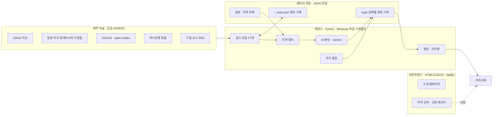

# 놓치지마 (nochijima)

> 해외에 있는 소중한 사람이 사는 지역에서 생긴 **지진·재난·환율·현지 뉴스**를 자동으로 살펴보고, 중요한 것만 골라 **한국어로, 카카오톡으로** 먼저 알려 주는 서비스입니다.
> 코딩을 배우지 않은 상태에서 **Claude Code**와 대화하며 만든 바이브 코딩 과제입니다.


---

## 목차

**Ⅰ. 서론 — 개발 배경 및 목적**
1. [개발 동기](#1-개발-동기)
2. [문제 정의 — 실제로 물어본 이야기](#2-문제-정의--실제로-물어본-이야기)
3. [유사 서비스 검토](#3-유사-서비스-검토)
4. [대상과 제공 기능](#4-대상과-제공-기능)

**Ⅱ. 본론 — 서비스 구현 상세**

5. [전체 구조](#5-전체-구조)
6. [사용 기술](#6-사용-기술)
7. [폴더 구조](#7-폴더-구조)
8. [핵심 기능 (모듈별 설명)](#8-핵심-기능-모듈별-설명)
9. [알림 하나가 만들어지기까지 (예시)](#9-알림-하나가-만들어지기까지-예시)
10. [틀린 알림을 줄이는 장치](#10-틀린-알림을-줄이는-장치)
11. [실행 방법](#11-실행-방법)
12. [Claude Code로 만든 과정 (바이브 코딩)](#12-claude-code로-만든-과정-바이브-코딩)
13. [시행착오와 해결](#13-시행착오와-해결)

**Ⅲ. 결론**

14. [결과](#14-결과)
15. [한계와 향후 보완 사항](#15-한계와-향후-보완-사항)
16. [실제 사용자 피드백](#16-실제-사용자-피드백)
17. [배운 점](#17-배운-점)

---

# Ⅰ. 서론 — 개발 배경 및 목적

## 1. 개발 동기

2026년 7월 28일, 일본 구마모토에서 지진이 났습니다. 저는 그 소식을 뉴스가 아니라 **일본에 사는 소중한 사람에게서 먼저** 들었습니다. 그 사람이 알려 주기 전까지는 아무것도 몰랐습니다.

그때 든 생각은 하나였습니다.

> **정보는 세상에 넘치는데, 나한테 제때 도착하지는 않는다.**

뉴스는 내가 찾아가야 보이고, 현지 재난 앱은 현지어라 읽기 어렵고, 한국 뉴스는 큰 사건이 아니면 늦거나 다루지 않습니다. 그래서 **"내가 고른 나라·지역에 일이 생기면, 한국어로, 매일 보는 카카오톡으로 먼저 알려 주는 것"** 을 직접 만들어 보기로 했습니다.

**목적:** 정보를 새로 만드는 서비스가 아니라, 이미 있는 정보를 필요한 사람에게 **"도달"시키는 서비스**를 만드는 것.

## 2. 문제 정의 — 실제로 물어본 이야기

해외에 가족·지인을 둔 사람들이 실제로 소식을 어떻게 챙기는지, 오픈채팅방에 들어가 직접 물어봤습니다 (2026년 10월).

| 들은 이야기 | 누구에게서 |
|---|---|
| 영사관(재난)·비자 사이트·환율을 **매일 직접 들어가서** 확인한다 | 해외 유학생 학부모 |
| 알아듣지 못하는 **현지 뉴스 채널을 틀어 두고**, 매일 은행에 들렀다 | 자녀 넷을 해외에 보낸 어머니 |
| 큰 사건(테러 등)은 **부모님이 한국 뉴스로 먼저 보고** 연락하는 경우가 많았다 | 영국 어학연수 경험자 |
| 요즘은 현지 거주자가 운영하는 SNS 채널로 소식을 접한다 | 일본 취업 관련 오픈채팅 |

정리하면 문제는 세 가지였습니다.

1. **언어** — 현지 공식 자료와 뉴스는 현지어라 읽기 어렵다
2. **찾아가야 함** — 여러 사이트를 매일 직접 확인해야 한다
3. **속도** — 한국 뉴스는 늦거나, 작은 지역 소식은 아예 다루지 않는다

## 3. 유사 서비스 검토

| 서비스 | 하는 일 | 놓치지마와 다른 점 |
|---|---|---|
| **외교부 '해외안전여행' 앱** | 국가별 여행경보·안전 공지 푸시, 위기상황 대처 안내 | **여행하는 본인** 중심, 나라 단위 경보. 도시 단위 재난·환율·현지 제도 변화는 다루지 않음. 앱 설치 필요 |
| **일본 관광청 'Safety tips' 앱** | 일본의 지진·쓰나미·기상 특보를 15개 언어(한국어 포함)로 푸시 | **일본만** 다룸(지역 5곳까지). 환율·제도 변화 없음. 앱 설치 필요 |
| **구글 알리미·뉴스 앱 키워드 알림** | 정한 키워드가 들어간 기사를 알려 줌 | 거르지 않아서 **관계없는 기사가 많고**, 현지어 기사는 그대로 옴 |
| **현지 한인 커뮤니티·SNS 채널** | 현지 사람이 소식을 빠르게 올림 | **내가 찾아가서** 봐야 함, 출처·정확도가 들쑥날쑥 |
| **은행 앱 환율 알림** | 정한 환율에 도달하면 알림 | **환율만** 다룸 |

**놓치지마의 차별점**
- 여러 나라를 **주·도·현·도시 단위**로 골라서
- 재난·환율·현지 제도 변화를 **한 곳에서**
- **한국어로 정리**해서
- 앱 설치 없이 **매일 쓰는 카카오톡**으로
- **여행자 본인이 아니라 한국에 있는 가족** 입장에서 보내 줌

## 4. 대상과 제공 기능

### 대상

| 대상 | 설명 |
|---|---|
| **해외에 자녀를 둔 부모** (핵심) | 유학생 학부모. 아이가 사는 도시의 재난·비자·환율이 늘 걱정인 사람 |
| **국제커플** | 연인·배우자가 다른 나라에 사는 사람 (만든 사람 본인도 여기에 해당) |
| **해외에 가족·지인이 있는 사람** | 해외 거주 가족, 장기 체류 지인 등 그 나라와 연결된 사람 |

### 제공 기능

| 알림 | 무엇을 보나 | 자료 출처 |
|---|---|---|
| 🌏 **지진** | 규모 4.0 이상, 고른 지역과의 거리 | 미국 지질조사국(USGS) |
| 🌧️ **기상·재난** | 폭우·홍수 특보, 태풍·산불·화산, 미국 토네이도 등 | 일본 기상청, 미국 기상청, 말레이시아 기상청, GDACS(UN·EU 재난 경보), open-meteo 강수량 |
| 💱 **환율** | 평소보다 크게 움직였을 때, 30일 최저·최고 | 하나은행 매매기준율 |
| 📰 **현지 뉴스** | 비자·체류·면허 등 규정 변경, 대형 인명사고 | 구글 뉴스 RSS + Google Gemini(AI 최종 판단) |
| 🗓 **브리핑** | 조용한 날에도 아침·저녁 한 번, 매주 요약 한 번 | 위 자료 종합 |

**다루지 않는 것:** 전쟁·정치 분쟁. 너무 복잡하고 민감해서, 사실을 짧게 전달하는 알림에는 맞지 않는다고 판단했습니다.

---

# Ⅱ. 본론 — 서비스 구현 상세

## 5. 전체 구조

놓치지마는 크게 **프론트엔드(웹페이지)**, **백엔드(감시·판단·발송 프로그램)**, **데이터 저장(JSON 파일)**, **외부 서비스(공공 API·AI·카카오)** 네 부분으로 나뉩니다. 별도의 데이터베이스 서버 없이, 필요한 기록은 **JSON 파일**로 저장합니다.



(그림이 보이지 않는 환경을 위한 요약)

```
[공공 API·RSS] → 감시 모듈 → 지역 필터 → AI 판단(뉴스만) → logs/ 기록 → 발송·브리핑 → 카카오톡
                     ↕                                    ↑
               *_seen.json(중복)                     자기 점검·일일 점검
[홈페이지(Netlify)] → 카카오톡 채널로 신청
```

| 구성 | 역할 | 사용 기술 |
|---|---|---|
| **프론트엔드** | 서비스 소개, 알림 받을 지역 선택, 개인정보처리방침 | HTML · CSS · JavaScript, Netlify 배포 |
| **백엔드** | 자료 수집 → 거르기 → AI 판단 → 기록 → 발송 | Python 3.11, Windows 작업 스케줄러 |
| **데이터 저장** | 설정, 지역 목록(910곳), 이미 본 소식, 날짜별 알림 기록 | JSON 파일 (DB 서버 없음) |
| **외부 서비스** | 자료 출처, AI 판단, 메시지 발송 | 공공 API·RSS, Google Gemini API, Kakao REST API |

## 6. 사용 기술

| 분류 | 사용한 것 | 어디에 |
|---|---|---|
| 언어 | **Python 3.11** | 감시·판단·발송 프로그램 전체 |
| 언어 | **HTML · CSS · JavaScript** | 홈페이지 |
| 라이브러리 | 대부분 **표준 라이브러리** (urllib, json, xml, math, datetime 등) | API 호출, 데이터 처리, 거리 계산 |
| 라이브러리 | `holidays` (선택) | 주간 요약의 공휴일 표시 |
| 외부 API | USGS, JMA, NWS, MET Malaysia, GDACS, open-meteo, 구글 뉴스 RSS | 자료 수집 |
| 외부 API | **Google Gemini API** | 뉴스 최종 판단, 주간 요약 |
| 외부 API | **Kakao REST API** | 카카오톡 '나에게 보내기' 발송 |
| 실행 환경 | **Windows 작업 스케줄러** | 10분~1시간마다 자동 실행 |
| 배포 | **Netlify** | 홈페이지 |
| 개발 도구 | **Claude Code** | 설계·코딩·시험·문서화 전 과정 |
| 공개 데이터 | Wikidata · GeoNames | 30개국 910개 주·도·현 목록 만들기 |

## 7. 폴더 구조

```
NOCHIJIMA-VICE/
├─ code/                       ← 백엔드: 감시·판단·발송 프로그램 (.py)
│  ├─ 지진감시.py 등            감시 모듈
│  ├─ 지역필터.py · AI판단.py   판단 모듈
│  ├─ 카톡발송.py 등            발송 모듈
│  ├─ 자동실행기.py · 자가감시.py  관리 모듈
│  ├─ *_테스트.py              시험 (실제 발송 없음)
│  ├─ 나라이름.json · 도시약칭.json · 행정구역.json   ← 데이터: 지역·나라 이름
│  ├─ gemini_모델순서.json · gemini_한도.json          ← 데이터: AI 설정 (키 없음)
│  └─ *.example.json           키·설정 예시 (복사해서 사용)
├─ homepage/                   ← 프론트엔드: 소개·신청 페이지, 개인정보처리방침
├─ README.md                   ← 이 보고서
└─ .gitignore                  키·토큰·기록 파일이 올라가지 않게 막는 목록
```

> 실행할 때 생기는 `logs/`(알림 기록)와 `*_seen.json`(중복 기록), 그리고 키가 들어간 설정 파일은 `.gitignore`로 GitHub에 올리지 않습니다.

## 8. 핵심 기능 (모듈별 설명)

### 모듈 ① 감시 (자료 수집)

| 파일 | 하는 일 | 입력 → 출력 |
|---|---|---|
| `지진감시.py` | USGS에서 최근 지진을 받아 규모·거리로 거름 | USGS GeoJSON → 내 지역 근처 지진 |
| `일본기상청감시.py` `미국기상청감시.py` `말레이시아기상청감시.py` | 각 나라 기상청 특보 확인 | 기상청 API → 특보 목록 |
| `재난감시.py` | GDACS(UN·EU) 국제 재난 경보 | GDACS RSS → 태풍·홍수·화산 등 |
| `호우감시.py` | open-meteo 강수량으로 폭우 이중 감시 | 시간별 강수량 → 폭우 여부 |
| `환율감시.py` | 환율 변동 폭과 30일 최저·최고 | 매매기준율 → 큰 변동 여부 |
| `정책뉴스감시.py` `대형사고감시.py` | 현지 뉴스에서 규정 변경·대형 사고 찾기 | 구글 뉴스 RSS → 후보 기사 |

모든 감시 모듈은 같은 흐름으로 움직입니다: **받아 오기 → 기준으로 거르기 → 이미 본 소식 빼기 → 기록에 넣기.**

### 모듈 ② 지역 필터

- `지역필터.py`가 소식이 **내가 고른 지역 안이나 근처인지** 판단합니다.
- 30개국 **910개 주·도·현**과 도시 단위 목록(`행정구역.json`, `행정구역_만들기.py`로 공개 데이터에서 생성)을 씁니다.
- 지진·재난은 좌표로 **거리를 계산**해 재난 종류별 반경 안인지 봅니다 (10번 표 참고).

### 모듈 ③ AI 판단 (뉴스만)

- 키워드만으로 고르면 **다른 나라 기사**가 섞여 들어옵니다. 그래서 키워드로 1차, `AI판단.py`가 **Gemini로 2차** 판단합니다.
- 질문: "정말 그 나라 일인가? 가족에게 중요한가?"
- AI가 실패하거나 애매하면 **보내지 않고 보류**합니다.
- 실제로 잘못 나갔던 기사들을 모아 만든 시험(`AI판단_테스트.py`, **61건**)을 **세 번 연속 모두 맞힌 뒤** 적용했습니다.
- 대형 사고는 AI가 숫자만 뽑고, 규모 판단은 코드가 계산합니다(AI가 숫자를 부풀리지 않게).

### 모듈 ④ 기록 (데이터 저장)

- 보낼 알림은 `logs/` 폴더의 **날짜별 기록 파일**에 쌓습니다.
- 이미 본 소식은 `*_seen.json`에 남겨 **두 번 보내지 않습니다.** 같은 사건은 하나로 묶습니다.

### 모듈 ⑤ 발송 · 브리핑

- `카톡발송.py`가 기록에서 새 알림을 꺼내 **카카오톡 '나에게 보내기'** 로 보냅니다. 토큰은 `kakao_token.py`가 자동으로 새로 받습니다.
- `아침브리핑.py`는 아침·저녁 요약, `주간요약.py`·`주간리포트.py`는 일주일 요약을 보냅니다.
- 다른 사람에게 보내기 위한 **카카오 알림톡 템플릿 2종**('재난 알림', '제도 변화 알림')도 심사를 통과했습니다.

### 모듈 ⑥ 자기 점검

- `자동실행기.py`: 작업 스케줄러에서 각 감시를 주기적으로 실행
- `자가감시.py`: 감시가 **조용히 멈추지 않았는지** 확인 (워치독)
- `일일점검.py`: 하루 알림 품질 점검
- 브리핑 끝에 **'감시 정상 / 멈춤'** 을 표시합니다.

### 모듈 ⑦ 홈페이지 (프론트엔드)

- 서비스 소개, 알림 종류, 대상 안내
- 알림 받을 **나라·도시 선택**(신청 페이지), 카카오톡 채널로 신청
- 개인정보처리방침
- '실시간' 같은 과장 표현을 쓰지 않고 **"알림이 없다고 안전하다는 뜻은 아님"** 을 안내

### 화면

> 📷 아래 자리에 실제 화면 캡처를 넣습니다. (`images/` 폴더)

| 화면 | 이미지 |
|---|---|
| 홈페이지 첫 화면 |  |
| 지역 선택·신청 페이지 |  |
| 카카오톡 지진 알림 |  |
| 카카오톡 제도 변화 알림 |  |
| 카카오톡 아침 브리핑 (감시 정상 표시) |  |
| 감시 프로그램 실행 화면 (터미널) |  |
| Claude Code로 작업하는 화면 |  |

## 9. 알림 하나가 만들어지기까지 (예시)

일본 구마모토 근처에서 규모 5.0 지진이 났다고 가정하면:

1. **모으기** — 작업 스케줄러가 10분마다 `지진감시.py`를 실행 → USGS에서 새 지진을 받아 옴
2. **거르기** — 규모 4.0 이상인가? ✔ / 내가 고른 지역(구마모토현)에서 100km 안인가? ✔ / 이미 보낸 지진인가? ✘(처음)
3. **기록** — `logs/`에 "구마모토현 부근 규모 5.0 지진" 기록, `seen` 파일에 번호 저장
4. **보내기** — `카톡발송.py`가 새 기록을 찾아 카카오톡으로 전송
5. **다음 실행** — 같은 지진은 `seen`에 있으므로 다시 보내지 않음

## 10. 틀린 알림을 줄이는 장치

알림 서비스에서 가장 위험한 것은 **틀린 알림**과 **너무 많은 알림**입니다.

| 대상 | 기준 |
|---|---|
| 지역 단위 | 30개국 **910개 주·도·현** + 도시 단위로 "내 지역"을 판단 |
| 지진 반경 | 기본 100km, 규모 6 이상 300km, 규모 7 이상 500km |
| 그 밖의 재난 반경 | 폭우 30km · 사고 200km · 재난 300km · 태풍 600km |
| 환율 | 1%와 '평소 움직임 × 2.5' 중 큰 값을 넘을 때. 30일 최저·최고는 바로 알림 |
| 뉴스 출처 | 공영방송·국가 통신사·정부 발표 등 믿을 수 있는 출처 위주 |
| AI 판단 | 시험 61건을 세 번 연속 모두 맞힌 뒤 적용, 애매하면 보류 |
| 중복 | 이미 보낸 소식은 다시 보내지 않음, 같은 사건은 하나로 묶음 |
| 표현 | '실시간' 같은 과장 표현 금지, "알림이 없다고 안전하다는 뜻은 아님" 안내 |

## 11. 실행 방법

> ⚠️ 키·토큰은 코드에 직접 쓰지 않습니다. 예시 파일을 복사해 **내 컴퓨터에서만** 값을 넣고, 그 파일은 `.gitignore` 때문에 GitHub에 올라가지 않습니다.

1. Python 3.11 이상 설치 ([python.org](https://www.python.org/))
2. (선택) 주간 요약의 공휴일 표시용 패키지
   ```
   pip install holidays
   ```
3. `code` 폴더로 이동해 기록 폴더를 만듭니다.
   ```
   cd code
   mkdir logs
   ```
4. 예시 파일을 복사해 이름에서 `.example`을 뺍니다.

   | 예시 파일 | 만들 파일 | 넣을 값 |
   |---|---|---|
   | `gemini_config.example.json` | `gemini_config.json` | Gemini API 키 |
   | `kakao_config.example.json` | `kakao_config.json` | 카카오 REST API 키, Redirect URI |
   | `구독설정.example.json` | `구독설정.json` | 알림 받을 나라 |
   | `지역설정.example.json` | `지역설정.json` | (선택) 알림 받을 지역·도시 |
   | `주간요약_나라.example.json` | `주간요약_나라.json` | (선택) 주간 요약 대상 |

5. 카카오 토큰을 한 번 받습니다.
   ```
   py 카카오_토큰받기.py
   ```
6. `미국기상청감시.py`, `행정구역_만들기.py` 안의 `[연락처]`를 내 이메일로 바꿉니다 (미국 기상청 API가 연락처를 요구).
7. 하나씩 실행해 봅니다.
   ```
   py 지진감시.py
   py 환율감시.py
   py 카톡발송.py
   ```
8. 키 없이 해 볼 수 있는 시험
   ```
   py 환율감시_테스트.py
   ```
9. 홈페이지는 `homepage/index.html`을 브라우저로 열면 됩니다.

자동 실행은 Windows 작업 스케줄러에 `py 자동실행기.py 지진감시.py`처럼 등록합니다.

### 시연 영상

> 🎬 [YouTube 링크 넣기] — 홈페이지 둘러보기 → 감시 프로그램 실행 → 카카오톡으로 알림이 오는 모습

## 12. Claude Code로 만든 과정 (바이브 코딩)

코딩을 배운 적이 없는 상태에서 Claude Code(터미널에서 대화하며 코드를 만들고 실행하는 AI 도구)에게 **한국어로 원하는 것을 설명하고, 결과를 확인하고, 고쳐 달라고 하는 방식**으로 만들었습니다.

### 역할 분담

| 나 | Claude Code |
|---|---|
| 무엇을, 왜 만들지 정하기 | 설계와 코드 작성 |
| 기준 정하기 (어떤 알림이 필요한가) | 시험 파일 만들고 돌리기 |
| 실제 알림을 받아 보며 맞는지 확인 | 원인 찾고 고치기 |
| 틀린 점을 말로 설명 | 바꾼 내용 정리·문서화 |

### 작업 순서 (반복)

```
① 원하는 것을 말로 설명  →  ② Claude Code가 코드 작성·시험
        ▲                                   │
        │                                   ▼
④ 틀린 점을 다시 설명   ←  ③ 내가 실제 알림을 받아 보며 확인
```

### 만든 순서

1. **출처부터 조사** — "믿을 수 있는 공식 자료만 쓰자"는 원칙을 정하고, 나라별로 어떤 기관이 무료 API를 주는지 먼저 조사
2. **작은 감시 하나부터** — 환율·지진처럼 숫자로 판단되는 감시를 먼저 만들고, 실제 자료로 돌려 보며 기준을 다듬음
3. **카카오톡 연결** — '나에게 보내기'로 발송, 토큰 자동 갱신
4. **자동 실행과 자기 점검** — 작업 스케줄러로 주기 실행, 감시가 조용히 멈추는 문제를 겪은 뒤 `자가감시.py`·`일일점검.py` 추가
5. **AI로 뉴스 거르기** — 잘못 나갔던 기사로 시험 파일을 만들고, Gemini 판단이 모두 맞을 때까지 고침
6. **지역 필터·품질 개선** — 30개국 910개 주·도·현 목록 생성, 같은 사건 묶기·예보와 실측 구분

### AI에게 일을 잘 맡기기 위해 한 것

- **한 번에 하나씩** 요청 — 여러 기능을 한꺼번에 시키면 어디서 틀렸는지 찾기 어려움
- **무엇을, 왜, 어떤 기준으로**를 함께 말함 (예: 어느 나라, 어떤 규모 이상, 몇 km 안)
- **실제로 틀린 사례**를 그대로 보여 주고 고쳐 달라고 함
- 고친 뒤에는 **바뀐 점과 시험 결과**를 정리해 달라고 해서 직접 확인

### 함께 지킨 규칙

- 키·토큰은 코드에 쓰지 않고 별도 파일에만, 화면에 출력하지 않기
- 시험은 실제 발송 없이 (`*_테스트.py`)
- 고치기 전에 백업, 고친 뒤에는 시험으로 확인
- 확인되지 않은 숫자나 과장된 표현은 쓰지 않기

## 13. 시행착오와 해결

| 문제 | 해결 |
|---|---|
| 일본 토야마의 폭우(104mm)를 놓침 | open-meteo 강수량으로 폭우를 **이중 감시** |
| 미국 재해 알림이 너무 많이 옴 | 기준을 올리지 않고 **묶어서 한 번에** 보내도록 변경 |
| 예보 수치까지 잡아 실제 12mm 비를 36mm로 감지 | 실측과 예보를 나눠 기록하며 시험 |
| 노트북 배터리가 꺼져 며칠 동안 감시가 멈춤 | 브리핑 끝에 **'감시 정상/멈춤' 표시**, `자가감시.py` 추가 |
| 키워드만으로는 다른 나라 기사가 섞임 | **AI 2차 판단** + 실패 사례로 만든 시험 파일 |
| 잘못 나간 알림이 쌓임 | 오류 기록 파일로 **유형별 관리** |
| 일본 지진 알림이 너무 잦음 | 일본 지진 기준을 규모 4.5로 조정 |

---

# Ⅲ. 결론

## 14. 결과

| 항목 | 결과 |
|---|---|
| 감시하는 나라 | 30개국 |
| 지역 단위 | 910개 주·도·현 + 도시 |
| 자동 감시 프로그램 | 17개 (작업 스케줄러로 자동 실행) |
| 정책 뉴스 감시 | 9개국 시험, 7개국(일본·베트남·대만·태국·캐나다·호주·필리핀) 안정 작동 |
| AI 판단 시험 | 61건, 세 번 연속 모두 정답 |
| 카카오 알림톡 템플릿 | '재난 알림', '제도 변화 알림' 2종 심사 승인 |
| 기타 | 카카오톡 채널, 소개 홈페이지, 인스타그램 소개 영상 |

실제로 잡아낸 변화 예시:

| 나라 | 잡아낸 변화 |
|---|---|
| 🇯🇵 일본 | 영주허가 심사 엄격화 |
| 🇹🇭 태국 | 60일 무비자 체류를 30일·15일로 줄이는 방안 검토 |
| 🇨🇦 캐나다 | 취업허가 발급 제한 |

## 15. 한계와 향후 보완 사항

| 한계 | 향후 보완 |
|---|---|
| 노트북 한 대에서 돌아가서, 꺼지면 감시가 멈춤 (현재는 감시를 멈추고 보관 중) | 클라우드 서버로 옮겨 24시간 실행 |
| 뉴스 기반 알림은 1시간 이상 늦을 수 있음 | 공식 기관 API가 있는 항목부터 우선 |
| 지금은 '나에게 보내기'라 나만 받음 | 승인받은 카카오 알림톡으로 다른 사람에게 발송 |
| AI 판단이 처음 보는 유형에서 틀릴 수 있음 | 틀린 사례를 계속 시험 파일에 추가 |
| 일부 무료 자료는 상업적 이용에 조건이 있음 | 이용 약관 확인 후 대체 자료 검토 |
| 나라·도시 단위라, 부모에게 정말 필요한 **학교 단위 소식**은 없음 | 학교 공지·이메일을 정리해 주는 기능 검토 |

## 16. 실제 사용자 피드백

| 누구 | 방식 | 피드백 |
|---|---|---|
| **만든 사람 본인** | 2주 동안 말레이시아 쿠알라룸푸르 알림만 받아 봄 | 알림은 정확했지만, 조용한 날이 많아 **매일 열어 볼 이유는 약했다.** 정보는 AI에게 물으면 1분이면 나온다 |
| **첫 체험자** (해외에서 한국 학생을 가르치는 학원 운영자) | 실제 알림을 받아 봄 | 알림 자체는 문제없지만, 부모 입장에서는 나라·도시 소식보다 **아이가 다니는 학교 단위 정보**가 더 필요하다 |
| **처음 보는 신청자** (자녀가 일본 미야자키·후쿠오카에 있음) | 홈페이지로 신청 | 걱정하는 것은 **재난과 사고** — 도시 단위로 고를 수 있어야 한다는 설계가 맞았다 |
| **외부 의견** | 직접 상담 | 현지 한인 커뮤니티가 이미 소식을 빠르게 알려 주므로, **"나만 줄 수 있는 것"이 필요**하다 |

피드백을 정리하면, **"정확하게 도달시키는 것"은 해냈지만, 사람들이 계속 쓰게 만들 이유는 아직 부족하다**는 것입니다.

## 17. 배운 점

1. **정보는 AI에게 물으면 1분이면 나온다.** 그래서 정보만으로는 계속 쓸 이유가 약하다. "도달"과 "믿을 수 있음"이 더 중요했다.
2. **기능을 늘리기 전에 '누가, 왜 계속 쓰나'를 먼저 확인해야 한다.** 만들기는 빨라졌지만, 사람들의 실제 행동은 직접 물어봐야만 알 수 있었다.
3. **바이브 코딩으로 만드는 속도는 정말 빨라졌다.** 코딩을 배우지 않고도 30개국을 감시하는 시스템을 만들 수 있었다. 그래서 오히려 **무엇을 만들지 검증하는 일**이 더 중요해졌다.
4. **AI에게 일을 맡겨도 판단과 확인은 사람이 해야 한다.** 틀린 알림을 찾아낸 건 매일 실제로 알림을 받아 본 나였고, AI는 그걸 빠르게 고쳐 주는 역할이었다.

---

※ 공개 API·데이터는 각 제공 기관의 이용 약관을 따릅니다. 이 저장소는 학습·과제용입니다.
